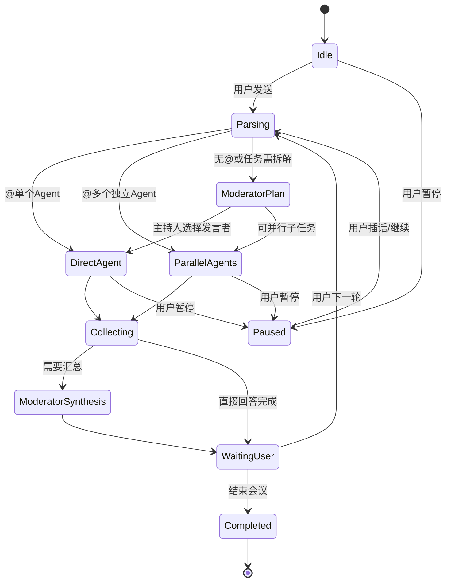
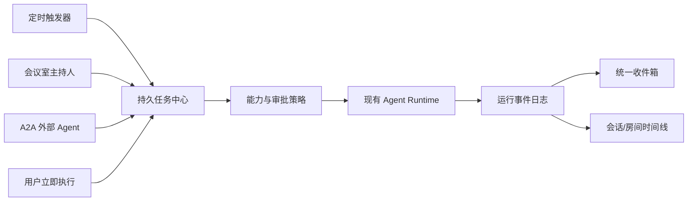
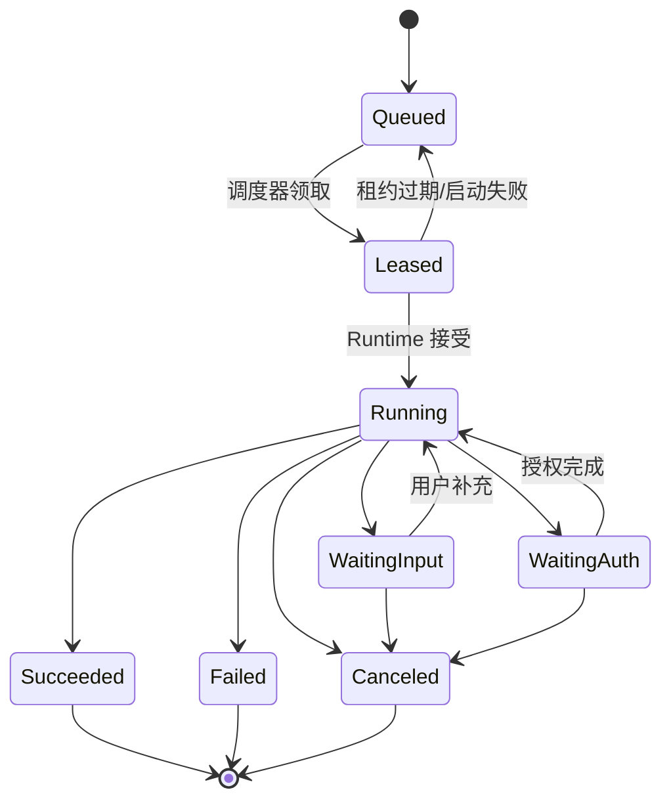

# Eta 独立增强分支：研究结论与实施计划

> 说明：本文保留原始研究与实施设计。当前代码完成度、自动测试结果和真机验证边界请看 [2026-11-06 项目状态](PROJECT_STATUS_2026-11-06.md)。

> 状态：仅完成源码研究、方案设计与风险审计。本文档生成时没有修改应用源码，也没有执行任何 Git 操作。用户已同意在整个项目完成并由用户确认后再启用 Git；在该确认到来前继续保持 Git 冻结。
>
> 研究基线：上游 `16893be5`（2026-11-03），本地增强分支相对该提交为 `0 ahead / 327 behind`。本文所有结论均以 `upstream-current/` 中的最新上游快照和当前 fork 源码为依据。

## 1. 实施结论

这组需求适合在一个以最新上游为底座、但把新增能力隔离在 fork 扩展层中的长期维护分支里完成。核心策略如下：

1. 保留现有 `applicationId = fuck.andes`，以支持覆盖安装和原有数据升级；源码命名空间采用上游的 `io.github.mangi.eta`，避免每轮同步都做全量包名替换。
2. 一次性完成 `fuck_andes.db` v8 → 上游 `eta.db` v24、偏好设置与工作区数据的迁移；完成前不进入主界面，删除破坏性迁移。
3. 文件夹、归档、子代理模型绑定、会议室、压缩审计和学习候选放入独立的 `eta_fork.db`，通过稳定的 `conversation_id` 与上游数据关联。上游继续拥有会话正文、消息和现有置顶字段。
4. 所有新增界面都复用 Miuix 0.9.4、现有 `MiuixTheme` token、`squircleSurface`、`textureBlur`、`WindowListPopup`、侧栏尺寸表和动效。新增功能不能引入第二套视觉语言。
5. 会议室采用“主持人监督器 + Agent 作为工具”的受控拓扑。用户 `@` 一个 Agent 时直接执行；`@` 多个 Agent 时并行执行互相独立的任务；未 `@` 时由主持人选择发言者；最终由主持人汇总或等待用户指定下一轮。
6. 上下文压缩从“85% 总窗口的单次摘要”升级为“预算预留 + 估算兜底 + 分块摘要 + 工具结果降级 + 可恢复快照 + 溢出重试”。
7. 自我学习采用候选、证据、验证、晋升和回滚流水线。自动学习可以整理候选，但提示词、技能权限和工具权限的永久变更默认需要用户确认。
8. 定时任务、会议室和外部 A2A Agent 共用一套持久化任务引擎，包含 durable lease、幂等键、事件日志、取消、审批、预算和恢复。
9. A2A 先实现安全的客户端与“外部参与者”能力；需要对外接收任务时，通过可选常驻伴生网关提供稳定入口，首版不把手机应用直接暴露成公网 A2A Server。

## 2. 当前实现与差距

### 2.1 会话与界面

- 上游已有置顶字段 `conversations.is_pinned`、置顶分组和菜单操作，但仍处于数据库 v24 的 `MIGRATION_23_24`。
- `AgentChatBody.kt` 已用 `rememberLayerBackdrop`、`textureBlur` 和 `BlendColorEntry` 做真实磨砂；输入区位于 `AgentChatBottomBar`，这是新会话胶囊可以严格复用现有视觉的位置。
- `AgentChatInputBar.kt` 现有输入容器使用 20dp squircle、`surfaceContainer`、0.5dp 半透明 outline、8dp 黑色 8% 阴影和 16dp 外侧布局留白。新增按钮应复用这些尺度。
- `AgentAppShell.kt` 右上菜单第一项仍是“新建会话”，需要改为“新建会议室”；“新建会话”迁到输入框上方。
- `ConversationPanePanel.kt` 现有行高至少 44dp、圆角 14dp、左右 16dp、上下 11dp，并有置顶、长按菜单和抽屉动效。文件夹和滑动操作必须建立在这套尺寸和交互上。
- `ArchivedConversationRequest.kt` 是导入外部运行归档的入口，不等于产品级会话归档。
- 现有导出包括单会话 Markdown 和整应用 `.eta-backup.json`。产品级归档应继续保留 Markdown，同时新增可恢复的单会话/批量归档包。

### 2.2 子代理

- `SubagentProfile` 已支持内置 explore/coder/plan、自定义 Markdown、工具白名单和临时角色。
- `SubagentExecutor` 已支持独立上下文、进度事件、并发和可续接会话，但只接收一个全局 `configProvider()`。
- 当前 `SubagentSettings` 只有一个全局 `modelId` 和一个全局 `reasoningEffort`，不能为每个 Profile 指定模型。

### 2.3 记忆与压缩

- Eta 已有成熟的 `MEMORY.md`、CAS 修订、标题索引、核心记忆注入、分页检索和会话内记忆 pin。它解决的是“可编辑、稳定注入的长期记忆”，还不是完整学习系统。
- `AgentContextSession` 只依据 provider 实际返回的 input usage，且以完整上下文窗口的 85% 为阈值。该阈值没有为输出、工具 schema、图片描述和协议开销留出独立预算。
- provider 不返回 usage 时永不自动压缩；首次请求前也不估算 token。
- `AgentContextSummarizer` 一次摘要全部完成历史，且摘要限制为 12,000 字符；源历史过大时摘要请求本身可能溢出。
- 失败后没有分块、降级、冷却和明确的用户恢复入口。已有成功快照和原上下文保留机制值得保留。

### 2.4 工程与安全

- 两个数据库都启用了 `fallbackToDestructiveMigration(dropAllTables = true)`，版本不匹配时可能静默清空数据，必须在升级底座前移除。
- API Key 进入 Room、RemotePreferences 和 Binder 的路径仍需要加密边界和最小暴露审计。
- Root、设备控制和 accessibility 输出缺少统一的字节上限、总时限与取消栅栏；部分子进程在协程取消后仍可能存活。
- HTTP/SSE 仍需要总 deadline、空闲 deadline、响应总字节上限和错误分类。
- 上游现有 `set_alarm`/`set_timer` 是设备工具，会调用系统闹钟/计时器界面；项目还没有持久化 Agent 定时任务引擎，也没有 WorkManager 依赖。
- 上游源码中未发现 A2A Agent Card、远端任务映射、流式事件或 A2A 传输实现；A2A 需要作为独立协议层新增。
- 当前机器只安装了 Android SDK 34，而上游要求 `compileSdk 37`、`targetSdk 37`。真正开始实现前必须安装并锁定 Build Tools 和验证环境。
- 工作区没有 Git 元数据，且当前指令为“不得随意 GIT”。用户已同意在整个项目实现完成并确认后启用 Git；该确认到来前继续冻结所有初始化、拉取、分支、合并和提交操作。

## 3. 主流多代理方案调研与取舍

| 方案 | 主要模式 | 适用场景 | 对本项目的取舍 |
| --- | --- | --- | --- |
| OpenAI Agents SDK | Agents as tools 保持管理者拥有最终控制；handoff 转移会话所有权 | 需要汇总、隔离上下文或明确升级责任 | 主模式采用 agents-as-tools；handoff 只预留为显式升级动作 |
| LangGraph | Network、Supervisor、Hierarchical、Custom | 复杂状态机和可审计路由 | 采用 Supervisor + 自定义状态机；禁止无界 network 互相聊天 |
| AutoGen SelectorGroupChat | 模型按共享上下文选择下一位发言者，可广播、缩窄候选并终止 | 讨论式多代理 | 借鉴选择发言者和终止条件，不照搬全体共享完整内部上下文 |
| Anthropic 多代理研究系统 | Orchestrator-worker，多代理适合并行研究和独立分析 | 广度和速度，成本约为普通聊天的 15 倍 | 并行只用于可独立拆分的任务，并设置房间级 token、并发与回合上限 |
| CrewAI hierarchical process | 一个 manager 负责委派并形成委派链 | 明确层级协作 | 主持人拥有路由和编制权，但不替代所有参与者的回答 |

结论是一个房间只允许一个主持人协调，参与者工具和私有上下文相互隔离，用户直接提及时拥有最高优先级。

官方参考：

- [OpenAI Agents SDK: Multi-agent](https://openai.github.io/openai-agents-python/multi_agent/)
- [LangGraph: Multi-agent](https://raw.githubusercontent.com/langchain-ai/langgraphjs/main/docs/docs/concepts/multi_agent.md)
- [AutoGen: SelectorGroupChat](https://microsoft.github.io/autogen/stable/user-guide/agentchat-user-guide/selector-group-chat.html)
- [Anthropic: How we built our multi-agent research system](https://www.anthropic.com/engineering/multi-agent-research-system)
- [CrewAI: Processes](https://docs.crewai.com/en/concepts/processes)

## 4. 严格复用现有 UI 的统一规则

### 4.1 不允许另造一套视觉体系

- 颜色只取 `MiuixTheme.colorScheme`：主按钮用 `primary` 系，普通玻璃底面用 `surfaceContainer` 或当前的 72% `surface` 混合，边框用 `outline.copy(alpha = 0.55f)`，正文用 `onSurface`/`onSurfaceVariantSummary`。
- 字体只取 `MiuixTheme.textStyles`，不新增字号、字重或行高 token。
- 形状复用现有 20dp squircle；会话行复用 14dp 圆角；侧栏容器复用 `conversationPaneContainerColor()`。
- 动画优先复用 `ConversationPaneMotion`、`AgentChatInputBar` 中已有的 `fadeIn`/`fadeOut`/spring 参数和抽屉位移。
- 触觉反馈统一使用 `LocalHapticFeedback` 与现有 Miuix 控件的默认反馈，不在不同页面引入不同反馈类型。
- 所有弹层使用 `WindowListPopup`、`ListPopupColumn` 和现有 `DropdownImpl`；`@` 建议列表沿用同一弹出层定位逻辑。
- 深色、浅色、字体缩放 1.0/1.3、360dp/412dp/600dp 宽度都必须做截图基线。

### 4.2 底部“新建会话”胶囊

位置：

- 放在 `AgentChatBottomBar` 的 `AgentChatInputBar` 上方，仍处于 16dp 左右边距的底部容器中。
- 胶囊与输入框之间使用 8dp 垂直间距，不悬浮到消息正文上方，也不替换现有滚动区域。

外观：

- 最小高度 40dp，左右内容内边距 16dp，图标 16dp，文字使用 `body1` 或现有按钮最近等级。
- 使用完整胶囊半径 `height / 2`，与现有输入框 20dp squircle 的轮廓一致。
- 有消息背景时复用 `messageBackdrop` + `textureBlur(blurRadius = 20f)`；不支持运行时 shader 或关闭模糊时回退到 `surfaceContainer`，不能变成透明悬浮层。
- outline 为 0.5dp `outline.copy(alpha = 0.55f)`，阴影保持现有 `radius 8dp / alpha 0.08`。
- 文案使用新增字符串资源，不硬编码。

交互：

- 点击调用现有 `AgentAppState.createConversation()`，不复制新建流程。
- 当前若有未发送草稿，沿用现有“新会话前保存当前草稿”的策略；若当前正在流式运行，先按现有新会话规则处理后台任务。
- 点击触觉、禁用态、TalkBack 描述和键盘避让都使用现有控件行为。
- 键盘升起时胶囊与输入框一起被 `imePadding()` 推起。

### 4.3 右上菜单

- 第一项文案从“新建会话”改为“新建会议室”，图标改为会议室语义，但仍用现有 Miuix `DropdownItem`。
- 点击打开房间创建页；在未选择参与者前不创建空房间。
- 其它菜单项顺序不变，避免用户已有肌肉记忆发生额外变化。

## 5. 会话置顶、文件夹、归档与导出

### 5.1 数据模型

建议放入独立 `eta_fork.db`，并使用逻辑外键关联上游 `eta.db` 的 conversation ID。

`conversation_ext`：

- `conversation_id` 主键
- `kind`：`chat` / `meeting`
- `folder_id`
- `folder_sort_order`
- `last_active_at`
- `archived_at`
- `archive_reason`：`manual` / `idle` / `recovered`
- `auto_archived`
- `auto_archive_exempt`

`conversation_folders`：

- `id`、`parent_id`、`name`、`sort_order`、`created_at`、`updated_at`
- 最多三层，禁止自引用和循环；删除文件夹时仅将子会话移回未分组，不删除会话。

置顶继续使用上游 `conversations.is_pinned`。这样上游已有的置顶同步、备份和列表投影继续生效。

### 5.2 右滑置顶

- 仅对会话行启用右滑，抽屉边缘关闭手势仍由外层侧栏优先处理，避免边缘冲突。
- 使用 `AnchoredDraggable` 或等价手势状态，只有越过最小阈值并松手才提交，避免水平滚动静默误触。
- 显示现有 `PushPin` 图标；置顶后执行现有 `onConversationTogglePin`，使用同一 haptic、列表分组 spring 动画和滚动位置稳定策略。
- 已置顶行右滑显示“取消置顶”，不使用第二套按钮。
- 长按菜单继续保留置顶/取消置顶，作为 TalkBack、鼠标和无手势用户的等价入口。
- 同一时刻最多展开一行；开始垂直滚动、打开菜单或切换会话时立即收拢。

### 5.3 文件夹

- 抽屉顺序：置顶区 → 未分组 → 文件夹树 → 日期分组。
- 文件夹行复用侧栏标题的 16dp 文本基线、44dp 最小触控高度和现有展开 spring；不使用卡片式列表。
- 会话菜单增加“移到文件夹”，文件夹选择器沿用 `WindowListPopup`。
- 文件夹内支持重命名、排序、移动和删除空文件夹；删除非空文件夹必须确认，并明确“会话回到未分组”。
- 搜索会跨普通区、文件夹和归档结果；搜索时临时平铺结果并显示来源标签。

### 5.4 归档语义

归档是软隐藏，不删除消息、附件、检查点或导出能力。

- 手动归档：`archived_at` 不为空，`auto_archived = false`。
- 自动归档：`archive_reason = idle`，`auto_archived = true`。
- 置顶会话自动免于空闲归档。用户可选择“文件夹免归档”作为后续扩展，首版不做隐式规则。
- 正在运行、等待工具结果或被用户固定保留的会话不能自动归档。
- 打开自动归档会话时立即解除归档；打开手动归档会话只允许查看，点击继续后需要明确解除。
- 归档后仍可从归档列表执行 Markdown 导出和完整归档包导出。

### 5.5 自动归档设置

在现有 Settings 的 Miuix 二级页中增加：

1. “自动归档”总开关，默认关闭。
2. “无活动天数”，开启后默认 30 天，提供 7/14/30/60/90 天或正整数输入。
3. “跳过置顶会话”固定为开启，并在说明中写清。
4. “立即检查”显示预计归档数量，执行前可预览。
5. 最近一次检查时间、下一次检查时间和错误状态。

调度策略参考 Hermes，但不直接照搬 3 天默认值：

- 应用启动后空闲 30 秒执行一次限频检查，24 小时内最多成功扫描一次。
- 分页批量处理，每批最多 100 条，在一个事务中更新元数据和审计记录。
- 浏览抽屉不触发扫描。
- 可在后续版本用 WorkManager 做低频兜底，自动归档不承诺精确到小时。
- `last_active_at` 在用户打开会话或发送消息时更新，不把后台模型心跳算作使用。

### 5.6 导出格式

保留现有 Markdown 单会话导出，并新增 `.eta-conversation.zip`：

- `manifest.json`：格式版本、导出时间、conversation ID、创建/更新时间、app schema、checksum。
- `conversation.json`：元数据、文件夹、归档原因、当前模型和检查点索引。
- `messages.jsonl`：分页写入的完整消息、工具调用/结果、引用和附件引用。
- `checkpoints/`：压缩快照与可恢复历史指针。
- `attachments/`：仅导出应用自己持有的普通文件。
- 不包含 API Key、Keystore 凭据或临时访问令牌。

导入必须是两阶段提交：先校验 manifest、版本、数量、路径和 checksum，再写入临时目录；只有全部验证通过后才生成新 conversation ID 并合并。拒绝绝对路径、`..`、符号链接、设备文件和超限压缩比。

## 6. 子代理独立模型与能力增强

### 6.1 设置模型

新增 `agent_profile_settings`，主键为稳定 profile key，保存：

- `provider_id`、`model_id`
- `reasoning_effort`
- `max_output_tokens`
- `context_budget`
- `tool_allowlist_json`
- `timeout_seconds`
- `max_turns`
- `max_cost_or_token_budget`
- `fallback_policy`

Profile 的 Markdown 继续保存角色、职责和工具建议，作为可移植定义；本地 provider/model ID 属于设备配置，不写回 Markdown。

解析顺序：

1. 本次显式调用参数
2. Profile 绑定
3. 全局 SubagentSettings
4. 主会话模型

如果绑定模型被禁用、provider 缺失、能力不匹配或认证失败：

- 不静默换成昂贵模型。
- 默认回退到全局 SubagentSettings，并在 UI 显示回退原因。
- 可配置为回退到主会话模型或直接失败。

### 6.2 执行器改造

- `SubagentExecutor` 接收 `resolveConfig(profile): ModelConfig`，不再只持有单个全局 config。
- 每个子代理使用自己的 context window、输出预留和压缩策略。
- 工具目录仍是 Profile 白名单与全局能力的交集；房间级安全策略可以进一步收窄。
- 子代理会话记录实际 provider/model/reasoning/tool-policy revision，恢复时若环境已变必须提示并重新解析。
- 并发上限、超时和取消按 profile 执行；父会话停止时通过结构化并发取消全体子代理及其子进程。
- Subagent Activity 面板显示模型、已用 token/时间、当前工具、失败与回退，并使用现有 `SubagentActivitySheet` 风格。

## 7. 多 Agent 会议室

### 7.1 产品定义

会议室是一种可置顶、可归档、可导出的会话类型，和普通聊天共用侧栏、文件夹、搜索与归档，不建立独立的应用壳层。

房间包含：

- 一个可见主持人，负责拆题、选择发言者和汇总。
- 1 到 8 个参与者；首版建议默认最多 4 个并发执行。
- 参与者可以有显示名、头像、Profile、独立模型、工具权限和独立私有上下文。
- 一条共享可见时间线；内部思维链、原始工具详情和私有会话不广播给其他 Agent。

### 7.2 路由状态机



规则：

- 用户消息没有提及时，主持人返回结构化路由决定：`speakers[]`、每个任务、并行/串行、是否需要汇总。
- `@一个` 直接建立 addressed task，主持人默认不重复回答。
- `@多个` 时，每个参与者只看房间 brief、自己的任务和用户选中的引用；独立任务并行。存在依赖的讨论由主持人串行安排。
- Agent 默认不能任意点名其他 Agent。需要协作时通过主持人或房间工具请求下一发言者，避免无限 ping-pong。
- 主持人汇总只使用可见消息和参与者结构化结果，不读取其他 Agent 的隐藏思考。
- 用户可插话、暂停、停止、重试单个参与者、移除参与者或要求新的一轮。

### 7.3 数据模型

`meeting_rooms`：房间、主持人、路由策略、状态、预算和版本。

`meeting_participants`：房间成员、profile key、显示名、头像、模型绑定、角色、顺序、启用状态。

`meeting_tasks`：目标、被指派参与者、依赖任务、状态、预算、重试次数和结果引用。

`meeting_messages`：

- `id`、`room_id`、`turn_id`、`task_id`
- `sender_type`：`user` / `agent` / `system` / `moderator`
- `sender_id`
- `mentions_json`、`reply_to`
- `visibility`：`shared` / `private`
- `content_locator`、`tool_trace_locator`
- `created_at`、`status`

大文本复用分块存储，避免 CursorWindow 和 Binder 限制。

`meeting_events` 采用追加式事件日志记录开始、完成、取消、预算耗尽、工具审批、重试和最终发布，房间时间线由事件投影。

### 7.4 预算与安全

- 每个房间周期最多 8 个 Agent 回合、4 个并发 Agent、15 分钟总时限。
- 每个参与者和主持人都拥有独立 token/时间预算，房间总预算另行封顶。
- 写文件、终端、设备控制和高风险工具在多人房间中不能因为“另一个 Agent 已批准”而继承授权。
- 用户中断是最高优先级；停止后禁止已取消任务继续发布结果。
- 每个任务使用 `task_id + participant_id + attempt` 生成幂等键，避免重连重复。
- 当一个参与者失败时，其他独立任务仍可完成；主持人向用户报告失败，不伪造其结论。

### 7.5 界面

- 顶部仍使用现有 `SmallTopAppBar`，标题显示房间名，参与者用紧凑头像/状态行，不新增大型仪表盘。
- 房间成员与管理使用现有二级页和 popup；主持人有 badge 标识。
- 输入框沿用 `AgentChatInputBar`；输入 `@` 时用现有 popup 定位习惯显示参与者候选，选中后变 chip。
- Agent 回答沿用现有消息气泡和 Markdown 渲染，显示稳定头像色、名称、模型和任务状态。
- 并行时各消息独立进度/停止按钮；结果到达顺序不改变任务归属。
- 房间级停止、暂停、总结和清空安排在现有顶部/菜单位置，避免在输入框旁边堆放新图标。

## 8. 持久化任务中心与定时任务

### 8.1 统一执行底座

定时任务不应直接调用页面协程或单独维护一套后台循环。它、会议室参与者、A2A 远端任务、自动归档和学习 curator 都应提交到同一个持久化任务中心，再由任务中心调用现有 Agent Runtime。

核心职责：

- 持久化定义、计划时间、运行批次、租约、事件、审批和结果。
- 使用独立 `run_id` 和幂等键避免重复执行。
- 进程死亡、系统重启或网络恢复后从事件水位继续。
- 为所有后台执行提供统一预算、取消、通知和审计。
- 以 `AgentExecutionService` 承载前台可见的长任务；任务中心只负责编排，不复制模型运行时。



### 8.2 本地任务状态机



- 终态不可重启；再次运行创建新 attempt。
- 幂等键由 `automation_id + scheduled_for + target_id` 组成。
- 调度器以短租约和 heartbeat 领取任务；崩溃后由新进程接管过期租约。
- `waiting_input` 与 `waiting_auth` 会进入统一收件箱并发送通知。
- 用户取消必须有取消栅栏；取消后的迟到结果只能作为已取消运行的事件保留，不能写入会话或房间。

### 8.3 调度能力

首版支持：

- 单次执行。
- 每 N 分钟、小时或天重复。
- 每天/每周在指定本地时间执行。
- 起止日期、暂停、恢复、立即运行、跳过下一次。
- 网络、充电、电量、空闲等约束。
- 错过计划时的策略：尽快补跑一次、跳过、询问用户。
- 失败指数退避、最大重试次数和连续失败自动暂停。
- 时区、夏令时、系统时间变更与重启后的重新计算。

高级 RFC 5545 recurrence rule 和 cron 语法放到后续版本；首版用结构化字段，避免用户输入无法验证的 cron。

### 8.4 Android 落地方式

- 默认使用 WorkManager 做低频、可持续的触发和重新排程；它适应 Doze、重启和系统维护窗口，但不承诺精确到秒。
- 任务真正运行且用户应看到持续状态时，复用现有前台 `AgentExecutionService` 和通知。
- `AlarmManager` 只在功能与 Android 精确闹钟政策相符且用户明确需要时使用。普通 Agent 自动化默认接受分钟级误差，不把应用伪装成系统闹钟。
- 时间敏感提醒优先通过 CalendarContract 或系统时钟 Intent 交给用户确认，避免申请与应用核心功能不相称的精确闹钟权限。
- 监听重启、时区变化和系统时间变化并重算 `next_run_at`；用户强制停止后的恢复限制必须在 UI 明示。
- 每次触发只启动一个全局调度协调器，避免多个 Work 同时扫描和重复领取。
- 普通周期 WorkManager 的最短周期限制、前台服务时长限制和厂商后台策略都放入兼容测试。

### 8.5 数据模型

`automation_definitions`：名称、目标会话/房间/A2A context、Prompt 或会议任务模板、参与 Agent、模型策略、工具权限、通知策略、预算、启用状态和并发策略。

`automation_schedules`：单次或重复规则、timezone、next_run_at、catch-up 策略和暂停状态。

`automation_runs`：计划时间、尝试次数、本地 Agent run ID、幂等键、状态、结果引用和错误分类。

`automation_leases`：owner、expiry、heartbeat。

`automation_events`：调度、领取、启动、模型事件、工具事件、审批、暂停、取消、终态和重试。

`attention_items`：需要用户补充、授权、选择或修复的统一待办。

所有数据进入 `eta_fork.db`；会话正文和现有 Runtime Result 仍由上游存储。

### 8.6 产品界面

- 任何普通会话、会议室或已注册的 A2A Agent 都可通过现有溢出菜单创建“定时任务”；定时任务可以生成普通回复、运行一次完整会议室流程或提交远端 A2A Task。
- 设置页增加任务中心：即将运行、运行中、等待用户、已完成、失败、已暂停。
- 新建页使用现有 Miuix 二级页、`TextField`、`Switch`、选择器和 `WindowListPopup`，复用当前设置页排版。
- 用户可选择输出到原会话、新会话或会议室；默认原会话，避免生成大量孤立结果。
- 通知只显示任务名和摘要，不显示密钥或完整敏感输出。
- 高风险工具在无人值守任务中默认等待审批；可给明确、窄范围的操作建立限时授权。
- 每个任务显示最近一次成功、下次运行和预算消耗，不使用独立仪表盘视觉。

### 8.7 验收条件

- 同一 scheduled instant 在进程重启、网络重试和重复广播下只产生一个有效 attempt。
- 跨重启、时区变化、夏令时、手动改时间和离线后均按选定 catch-up 策略执行。
- 任务被取消后模型、工具和子进程都不能继续提交结果。
- 前后台限制、Doze、低电量和厂商杀进程场景有明确状态，不静默丢任务。
- 自动归档和 curator 能复用任务租约与事件日志，但不能执行用户可见的高权限动作绕过审批。

官方依据：

- [Android WorkManager](https://developer.android.com/develop/background-work/background-tasks/persistent/getting-started)
- [Android AlarmManager scheduling](https://developer.android.com/develop/background-work/services/alarms/schedule)
- [Android foreground services](https://developer.android.com/develop/background-work/services/fgs)

## 9. A2A 外部 Agent 互联

### 9.1 目标与版本

以 A2A `1.0.x` 为兼容线，实施时固定到 `1.0.1`，并在 HTTP 请求中按规范携带 `A2A-Version`。客户端必须拒绝不支持的版本，不能把不同版本的字段按猜测合并。

分三阶段：

1. **A2A Client / 外部参与者**：Eta 主动发现、调用、取消、订阅其他 Agent，是最先实现的主路径。
2. **A2A Host / 被动接收**：其他 Agent 主动请求 Eta。局域网 HTTP、用户显式填写的 HTTPS 入口和配对后的私有网络入口共用同一个 A2A HTTP 服务。
3. **可选移动组网**：在真机验证通过后，以内嵌 `tsnet` 加一次性设备注册提供稳定地址；手机只监听本机代理端口，不直接向公网绑定全部网卡。

不把 Android App 的临时后台进程直接暴露为公网服务器。移动网络、休眠、前台服务限制、推送可达性和证书轮换必须先满足验收门槛。`tsnet` 只负责传输可达性，Bearer、精确 Peer、ACL、权限和产物隔离仍由应用层强制执行。根因、风险、Android 限制、配对流程和验证门槛见 [A2A Mobile Transport Review](a2a-mobile-transport-review.md)。

### 9.2 协议映射

| A2A 对象 | Eta 映射 |
| --- | --- |
| Agent Card | `remote_agents` 注册项、能力、认证方式、版本、缓存和信任标签 |
| `contextId` | 普通会话、会议室或一条持续合作上下文 |
| `taskId` | `a2a_tasks` 远端任务 ID 到本地 task/run 的稳定映射 |
| `referenceTaskIds` | 后续 refinement 引用；终态任务本身不重启 |
| Message | 房间共享消息或可直接回答的短互动 |
| Task | 持久任务中心中的远端任务 |
| Artifact | 有 MIME、hash、大小、来源和保留策略的本地附件 |
| Task State | 映射到本地 Queued/Working/InputRequired/AuthRequired/Completed/Failed/Canceled/Rejected |
| Streaming Event | 追加到本地事件日志并投影到房间/任务详情 |
| Push Notification Config | 可选伴生网关或已验证的移动传输回调地址；无回调入口时回退到 stream/poll |

A2A 的 Completed、Failed、Canceled 和 Rejected 都是终态。用户在终态后继续要求修改时，创建同一 `contextId` 下的新任务并带 `referenceTaskIds`。

### 9.3 作为会议室参与者

- 参与者类型扩展为 `local_profile` 与 `remote_a2a`。
- 远端 Agent 有独立显示名、头像、Agent Card revision、认证状态、健康状态和信任等级。
- 主持人可以像分派本地 Agent 一样分派远端 Agent；用户仍可 `@` 一个或多个远端参与者。
- 远端只收到用户允许共享的房间 brief、被分派任务、引用消息和必要 artifacts，不接收本地私有会话上下文。
- 远端返回 `input-required` 时，房间暂停该分支并把澄清请求放入收件箱；`auth-required` 不得由后台模型自行完成授权。
- 远端 Agent Card 中的 skills 是声明，不是自动获得本地工具权限的依据。

### 9.4 发现与注册

首版采用手动 URL 或私有目录注册，自动发现只接受 HTTPS：

- Agent Card 路径支持标准 `/.well-known/agent-card.json`，并允许配置显式 URL。
- 支持 ETag、Cache-Control 和版本 hash；Card 变化后要求重新确认新增 capability 与认证范围。
- 公开 Card 只用于发现；敏感能力通过 extended card 与认证后的按需披露。
- 注册时显示 Agent Card 的域名、provider、协议版本、支持 stream/push、skills、认证方式和风险。

### 9.5 安全边界

- 默认仅 HTTPS，拒绝 loopback、link-local、私网、重定向到私网和 DNS rebinding。
- OAuth/OIDC、mTLS 或 API Key 通过 Keystore 加密保存；Card 与日志中不得出现静态密钥。
- HTTP/SSE 有总时限、空闲时限、响应大小、event 数量、artifact 数量和压缩比限制。
- 所有 Card、Message、Artifact 都视为不可信输入，执行本地工具前仍经过本地 capability 和 approval policy。
- Artifact 先写 quarantine，校验 MIME、hash、大小和文件名后原子移动；不允许路径穿越、符号链接或可执行文件自动打开。
- 每个远端上下文有最小化数据共享预览；第一次发送本地消息或附件需要用户确认。
- 恶意指令、工具诱导和跨 Agent prompt injection 使用来源标签隔离，远端内容不能改变本地系统权限。
- 取消会调用 A2A cancel；远端不支持或超时后停止本地订阅并标记 `cancel_unconfirmed`，不能假装已完成。

### 9.6 数据与界面

新增表：

- `remote_agents`
- `a2a_contexts`
- `a2a_tasks`
- `a2a_events`
- `a2a_artifacts`
- `a2a_auth_bindings`
- `a2a_push_bindings`

设置页提供 Agent 注册、连接测试、认证、health、capability diff、撤销和清除缓存。会议室参与者选择器增加“远程 Agent”，视觉仍使用现有 `WindowListPopup`、头像行和状态 footnote。

### 9.7 验收条件

- 通过官方示例或兼容实现完成 Card 发现、send、stream、get task、cancel 和 artifact 下载。
- 版本不支持、认证过期、输入补充、拒绝、失败、取消和终态后 refinement 都能正确投影。
- 重连和重复 stream event 不生成重复消息。
- 恶意 Card、超大响应、SSRF 重定向、错误 MIME、路径穿越和压缩炸弹被拒绝。
- 远端 `input-required`/`auth-required` 会进入收件箱，不能在后台自行选择敏感授权。
- 不暴露伴生网关时，A2A Client 在无公网入站回调的情况下仍能使用 stream 或轮询完成任务。

官方依据：

- [A2A 1.0 specification](https://a2a-protocol.org/v1.0.0/specification/)
- [A2A 1.0.1 release](https://github.com/a2aproject/A2A/releases/tag/v1.0.1)
- [Life of a Task](https://a2a-protocol.org/latest/topics/life-of-a-task/)
- [Agent Discovery](https://a2a-protocol.org/latest/topics/agent-discovery/)
- [Streaming and asynchronous operations](https://a2a-protocol.org/latest/topics/streaming-and-async/)

## 10. 建议一并强化的能力

### 10.1 统一收件箱

为 `input-required`、`auth-required`、工具审批、失败重试、A2A 推送冲突和定时任务异常提供唯一入口。把“需要人处理”与普通聊天通知分开，支持全部处理、跳转到触发它的事件和超时后安全暂停。

### 10.2 Capability Registry

建立统一目录，列出本地 Agent Profile、子代理、MCP server、A2A Agent 和系统能力。每项记录：

- 能力、模型、输入输出类型、stream/push 支持
- 认证与权限范围
- health、最后验证时间、版本和 hash
- 成本、延迟、离线可用性和失败率
- 用户信任等级和允许共享的数据类别

主持人、定时任务和选模器只从通过 capability/permission 检查的条目中选择候选。

### 10.3 Approval Policy

将审批从单次 UI 布尔值升级为可审计政策：

- 按工具、路径、域名、操作类型、会话/房间、Agent 和无人值守状态判断。
- 支持一次性、本次运行、固定时长和永久但可撤销授权。
- 高风险动作默认每次确认；无人值守任务不能因上游 Agent 声称已获授权而继承许可。
- 审批记录包含输入摘要、风险理由、批准范围和 expiry。

### 10.4 运行可观测性与成本控制

统一展示每次普通聊天、子代理、房间参与者和 A2A 远端的：

- 模型、provider、首 token/总延迟
- input/output/reasoning token、估算费用和上下文压缩
- 工具调用数量、失败、重试和人工审批
- 远端 Agent 的协议版本、网络阶段和 artifact 体积
- 以房间/任务/定时计划聚合的每日预算与硬上限

这些信息可导出用于调试，但不默认进入长期记忆，也不包含密钥或完整敏感正文。

### 10.5 Workflow / DAG

会议室和定时任务后续可复用一个有向无环工作流：每个节点是 Agent 调用、工具、人工审批或 A2A task，边表达依赖和并行。首版只开放主持人内部使用的串并行计划，用户必须先通过预览确认；避免把自由循环包装成可视化工作流。

### 10.6 可恢复性与离线性

- 远端断网、provider 失败或进程重启后，任务从事件水位恢复。
- 队列、审批和历史在离线时可查看，恢复网络后再继续。
- 用户可导出 automation 定义、房间模板、Agent Card 引用和本地 Agent Profile，导入前做版本与权限 diff。
- 完整备份与增量归档分离；不把 A2A 凭据写入普通会话导出。

### 10.7 伴生网关与多设备

当需要 A2A 入站、精确可靠回调或桌面/手机协同，可部署可选的自托管伴生网关。网关只做认证、持久队列、推送、Webhook 和加密中继，模型执行仍按用户选择在设备或受信任服务器完成。它是后续能力，不阻塞 A2A Client、会议室和定时任务首版。

建议纳入本次范围的核心增强是统一收件箱、Capability Registry、Approval Policy、运行可观测性和离线恢复。工作流编辑器、伴生网关和跨设备同步在核心稳定后实施。

## 11. 上下文压缩重构

### 11.1 新的预算模型

把模型窗口拆成：

```text
contextWindow = inputBudget + outputReserve + toolSchemaReserve + protocolSafetyMargin
triggerLimit = min(floor(contextWindow * 0.85), inputBudget - safetyMargin)
```

- output、tool schema 和 safety margin 来自模型能力与当前工具集，不能用固定百分比代替。
- 若 provider 返回实际 input usage，使用实际值。
- 若无 usage，用保守估算器统计文本、图片块、工具 JSON 和消息协议开销，并标记 `estimated=true`。
- 用实际 usage 校正估算误差的滑动平均；未知模型首次使用更早的保守阈值。
- 子代理和会议室参与者使用各自模型预算，不能使用父会话窗口。

### 11.2 压缩流水线

1. 发布 durability snapshot，记录源消息范围、revision、预计 token、模型与工具 schema revision。
2. 保留最近尾部：完整保留最近用户请求、其直接回答、未闭合工具对和必要引用。
3. 将旧工具结果降级为结构化 stub：工具名、参数 hash、状态、时间、可用检索 locator；只对最新工具结果保留完整内容。
4. 旧历史按 summarizer 可用预算分块；每块目标为摘要模型有效输入预算的 60%–70%。
5. 递归合并分块摘要，直到形成稳定 checkpoint；每层记录覆盖消息 ID 和摘要 hash。
6. 在 Room 事务中发布 watermark，之后才替换活动上下文；失败保留原上下文。
7. provider 报告上下文溢出时，最多在“无副作用且可安全重放”的情况下压缩并重试一次。只要本轮已有写文件、终端、消息发送等副作用，就不自动重放工具批次。

### 11.3 失败、冷却与恢复

- 摘要失败后设置 10 分钟冷却；若仍达到危险水位，先执行确定性工具结果降级。
- 紧急 fallback 只保留当前任务、最近尾部和已有 checkpoint，不压缩用户选择固定的记忆。
- 每次压缩产生可见 system notice，可打开详情页查看压缩前后 token、覆盖范围、失败原因和模型。
- 用户可导出压缩包、查看历史摘要和恢复旧快照。
- 增加压缩指标：触发来源、估算/实际、耗时、重试、失败阶段、节省 token、后续成功率和成本。
- 现有 `ConversationMemoryPins` 继续保证记忆注入在 checkpoints 之间使用稳定 revision。

### 11.4 验收不变量

- 任何压缩都不能丢失最近用户指令、未完成工具事务或可恢复的历史指针。
- 任意一次崩溃后，要么继续旧上下文，要么使用完整已发布快照，不能出现半提交。
- 已知 usage、未知 usage、provider overflow、摘要超时、摘要 429/5xx、取消和进程死亡场景都有测试。
- 1M 上下文、128K 上下文和 16K 上下文分别验证预算与保留尾部。

## 12. 自我学习增强

### 12.1 当前定位

Eta 已经拥有可编辑长期记忆，但当前缺少“从真实使用中形成候选、验证、晋升、使用统计和回滚”的闭环。目标不是静默修改系统提示词，而是把经验变成可审计资产。

### 12.2 学习流水线

1. 证据采集：从用户明确要求记住、完成后的对话/压缩 checkpoint、重复成功步骤、重复失败及修复中提取候选。
2. 隐私过滤：检测 API Key、令牌、身份证、电话、地址和用户要求不记忆的内容；从导出中剥离敏感片段。
3. 结构化候选：类型为 fact、preference、procedure、failure-fix；保存来源消息、conversation ID、excerpt hash、置信度、时间和适用范围。
4. 去重与冲突：与现有记忆/技能做相似度检查；冲突内容进入待确认，不能覆盖高置信度或固定记忆。
5. 验证：确定性规则优先；必要时用低成本辅助模型生成摘要，用检索评测和用户反馈验证。
6. 晋升：事实进入 `MEMORY.md`，可复用流程进入版本化 skill，短期上下文进入 episode；高影响工具权限或提示词变更需要用户确认。
7. 生命周期：记录 use count、last used、success rate、staleness、revision；支持 pin、merge、archive 和 rollback。
8. 维护：仅在真实聊天空闲后低频运行，参考 Hermes curator 的“首轮延后、限频、只处理 agent-created 资产、永久删除改为可恢复归档”原则。

### 12.3 数据与 UI

新增表：

- `learning_candidates`
- `learned_assets`
- `curator_runs`
- `learning_feedback`
- `asset_versions`

设置页提供：

- 自动整理候选开关
- 自动晋升低风险事实开关，默认关闭
- 技能/提示词变更“每次确认 / 信任低风险类别 / 全部手动”
- 学习范围与敏感数据排除规则
- 候选列表：证据、置信度、将写入的位置和预期影响
- 已学习资产：使用次数、成功率、版本、固定与回滚

首版使用确定性整理和低频 curator；财务、账号、权限、工具策略和跨用户内容不得自动晋升。

## 13. 上游同步与长期维护架构

### 13.1 底座

- 以 `16893be5` 为第一版整合底座，之后以明确的上游提交或 release tag 为唯一同步源。
- `applicationId` 固定为 `fuck.andes`，安装升级路径不变；`namespace` 跟随上游 `io.github.mangi.eta`，fork 自有代码放 `io.github.mangi.eta.fork.*`。
- 发布 `versionCode` 必须高于已安装版本，并继续递增；上游当前 `2026103101` 已高于 fork 的 `200`。
- release 之前必须确认旧包与新版使用同一签名密钥，否则 Android 不允许覆盖安装。

### 13.2 数据和偏好迁移

首次启动顺序：

1. 在任何 `EtaDatabase.get()` 或主界面启动前进入迁移闸门。
2. 检测 `files/databases/fuck_andes.db`，对 WAL 做 checkpoint，复制到同目录临时文件并执行 integrity check。
3. 在副本上升级 v8 → v24，不直接修改唯一副本。
4. 验证 conversation/message/checkpoint/provider 行数和关键字段 checksum。
5. 原子改名到 `eta.db`；保留只读迁移备份，并写入 migration manifest。
6. 映射 `fuck_andes_settings` → `eta_settings` 中可对应的键；不能映射的 fork 设置保留在扩展设置中。
7. 迁移成功后才移除迁移闸门。中途崩溃时下次从已验证副本重试。

保留现有 `6→7`、`7→8` 和上游全部 `8→24` migrations。删除 `fallbackToDestructiveMigration`；缺 migration 时升级必须失败，不能清库。

### 13.3 减少未来冲突

- 上游拥有的表继续归上游。Fork 新增表进入 `eta_fork.db`，减少主库 migration 冲突。
- 新 Repository、状态机、调度器、房间 UI 和学习 UI 放在 fork 包中；只在上游壳层保留必要入口。
- 建立 `docs/UPSTREAM_INTEGRATION_SEAMS.md`，登记每个有 fork 修改的上游文件和原因。
- 每次同步先生成 upstream diff 和 seam 命中报告，再在独立的整合环境中处理冲突。
- 为 UI 接缝保持参数向后兼容：新增回调先给默认值，能通过 wrapper 完成的功能不改上游函数主体。
- 同步前锁定 Room schema、上游提交、Miuix 版本、Compose 版本和 Android SDK。
- 每次上游更新至少运行 Room migration、seam API、UI golden 和关键 flow 测试。

建议的接缝文件：

| 区域 | 文件 |
| --- | --- |
| 新会话胶囊 | `AgentChatBody.kt`, `AgentChatInputBar.kt` |
| 右上菜单 | `AgentAppShell.kt`, `AgentAppRoot.kt` |
| 会话侧栏 | `ConversationPanePanel.kt`, `ConversationPaneState.kt`, `AgentAppState.kt` |
| 子代理模型 | `SubagentExecutor.kt`, `SubagentSettings.kt`, `SettingsDataStore.kt` |
| 定时执行 | `AgentRuntimeClient.kt`, `AgentExecutionService.kt`, `AndroidManifest.xml`，其余调度器放在 fork 包 |
| A2A | 新 fork 协议、注册表、网络与参与者适配器；只在上游壳层增加设置和参与者入口 |
| 压缩 | `AgentContextSession.kt`, `AgentContextCompactor.kt`, `AgentContextSummarizer.kt`, `AgentContextSnapshot.kt` |
| 主数据库底座 | `EtaDatabase.kt`, `EtaDatabaseMigrationTest.kt` |
| 导出 | `EtaBackupRepository.kt`, 单会话 exporter |

这些文件只做最小接缝修改；文件夹页、归档页、会议室控制器和学习候选页放在 fork 包内。

### 13.4 同步节奏

- 稳定期每 1–2 周读取一次上游差异，重大 release 前额外同步。
- 先同步到整合环境，不改可发布分支，先跑数据和 UI 回归。
- 上游 API 改动与 fork feature flag 解耦；未通过 seam 兼容测试的新上游版本不发布。
- 记录 upstream lock commit、迁移版本和 seam 清单，保证任何构建都能追溯到确切来源。

所有 Git 操作继续保持冻结；用户完成整个项目验收并明确确认后，再执行初始化、拉取、分支、合并和提交。

## 14. 安全、可靠性与性能修复

### 14.1 必须先修

- 移除所有破坏性 Room fallback。
- API Key 使用 Android Keystore 保护的 AES-GCM envelope；Room/Preferences 只存密文与 key alias。
- Binder 不传明文密钥；同进程直接注入 Repository，跨进程时只传短时 capability 或由独立服务从 Keystore 解密。
- Root/device/accessibility 命令统一设总 deadline、空闲 deadline、输出字节上限和取消栅栏；取消必须终止整个进程组。
- HTTP/SSE 增加连接/首字节/空闲/总时限、最大累计字节、最大事件数和明确错误分类。
- Runtime service、accessibility receiver 只导出必要组件，并验证调用者权限或签名。
- 会话加载保持分页；侧栏只读投影字段；归档扫描按批提交；搜索和分组避免重复全表读取。

### 14.2 测试与 CI

建立至少四组 CI：

1. JVM 单元测试、Room migration tests、静态检查。
2. Android instrumentation：v8 fixture 升级、归档扫描、归档导入导出、Keystore 加密、任务租约、重启/时区、会议室取消和 A2A 网络故障。
3. Compose screenshot / semantics：浅色深色、字体缩放、横竖屏、360/412/600dp、输入法和 TalkBack。
4. Release verification：applicationId、versionCode、签名、权限、导出组件、数据库版本和 upstream lock。

手工回归至少覆盖：

- 旧版覆盖安装后能看到所有旧会话、置顶、模型和设置。
- 新会话胶囊、右滑置顶、文件夹移动和归档不改变其它抽屉视觉。
- 自动归档不处理置顶/运行中会话，归档后仍可导出和恢复。
- 每个子代理使用独立模型，模型失效时按策略回退并提示。
- 定时任务在重复广播、重启、Doze、离线和时区变化后不重复、不静默丢失。
- 会议室能 `@` 单人和多人、暂停、插话、停止、失败隔离和最终汇总。
- A2A 远端 Agent 能作为单人或多人参与者工作，`input-required`、认证、取消和终态 refinement 正确进入收件箱。
- 压缩失败、进程被杀和 provider overflow 后仍能恢复上下文。
- 学习候选不会自动写入密钥、用户明确禁止的内容或外部/固定资产。

## 15. 分阶段实施顺序

### Phase 0：最新上游底座与零数据丢失升级

范围：

- 导入并固定上游 `16893be5` 源码。
- 保留 app ID 与签名路径，采用上游 namespace。
- 实施 v8→v24、DataStore 和工作区迁移闸门。
- 删除破坏性 fallback，补 migration fixture 和 schema 导出。
- 安装/锁定 SDK 37，建立构建和 CI。

完成条件：

- 真实 v8 fixture 升级后行数、关键 checksum 和抽样正文一致。
- 旧包覆盖安装成功，崩溃注入测试不会清库。
- 上游现有测试通过，UI 基线无回归。

### Phase 1：安全与运行时正确性

- 密钥加密和 Binder 最小暴露。
- 子进程取消、deadline、输出上限。
- HTTP/SSE deadline 和字节上限。
- 导出组件权限和分页/索引优化。

完成条件：安全单元测试、故障注入和长输出测试通过。

### Phase 2：会话体验

- 新会话玻璃胶囊。
- 右上菜单改为新建会议室。
- 右滑置顶、文件夹和归档列表。
- 自动归档设置、批量扫描、完整归档导出/导入。

完成条件：UI golden、手势、TalkBack、归档状态机和 round-trip 导出全部通过。

### Phase 3：子代理能力

- Profile 模型/推理/预算/工具绑定。
- 执行器按 Profile 解析配置和回退。
- 活动面板显示模型和预算。

完成条件：多模型并发、断点恢复、provider 故障和预算限制测试通过。

### Phase 4：持久任务中心与定时任务

- 任务定义、计划、运行、attempt、租约、事件、幂等、预算和恢复。
- WorkManager、前台执行、重启/时区处理和任务中心 UI。
- 统一收件箱、通知和无人值守审批策略。

完成条件：重复触发、崩溃、Doze、离线、取消和跨时区测试通过。

### Phase 5：会议室

- 房间数据模型、主持人、参与者、任务和事件日志。
- 无 `@`、单 `@`、多 `@`、并行/串行与汇总路由。
- 暂停、插话、停止、重试和失败隔离。
- Miuix 房间界面与 `@` 候选。

完成条件：房间状态机、幂等、取消、预算和无界循环防护测试通过。

### Phase 6：A2A Client 与外部参与者

- A2A 1.0.1 Agent Card、认证、发送、流式订阅、任务查询、取消与 artifact。
- `A2A-Version` 协商、状态映射、幂等、信任标签和恶意输入防护。
- 远端 Agent 加入会议室、收件箱处理和 Capability Registry。

完成条件：官方兼容测试、网络故障、版本错误、恶意响应和终态 refinement 测试通过。

对外接收 A2A 请求先支持用户开启的局域网/显式 HTTPS 入口，再通过独立阶段验证内嵌 `tsnet` 或伴生网关；移动传输 spike 不阻塞 Client 版本，也不能用共享预授权密钥或全接口监听换取“已经支持双向”的结论。

### Phase 7：压缩可靠性

- 预算模型、估算兜底、分块摘要、工具结果降级、快照和恢复 UI。
- provider overflow 处理和 telemetry。

完成条件：三类窗口、五类失败、崩溃恢复和真实模型的 smoke test 通过。

### Phase 8：学习闭环

- 候选、证据、去重、验证、晋升、固定、回滚和维护调度。
- 设置页和学习历史页。

完成条件：敏感信息、冲突、低置信度、用户撤回和 curator 回滚测试通过。

### Phase 9：上游同步与发布硬化

- seam 清单、upstream drift、schema/API 对照、性能回归和发布检查。
- 进行一次不发布的“假同步”演练，确认冲突只发生在预期接缝。

## 16. 风险与决策闸门

| 风险 | 影响 | 处理 |
| --- | --- | --- |
| 旧签名密钥不可用 | 无法覆盖安装 | Phase 0 先验证；不满足则必须由用户决定是否改用新包名 |
| v8 实际 schema 与上游历史 v8 不完全一致 | 数据迁移失败 | 用真实旧库 fixture 做 schema diff，额外写桥接 migration |
| 多 Agent token 成本膨胀 | 费用和延迟失控 | 房间、参与者、任务三级预算；默认 4 并发和 8 回合封顶 |
| 自由 Agent 互聊形成循环 | 无法终止 | 主持人受控路由；Agent 不可任意再次点名 |
| Android 后台限制导致任务延迟 | 用户误以为定时任务精确秒级触发 | UI 明示分钟级误差；系统级精确提醒交给 Calendar/Clock；异常状态可见 |
| 同一计划被重复触发 | 重复扣费或重复执行副作用 | 持久幂等键、短租约、事件水位和唯一 attempt |
| A2A 远端 Agent 不可信 | 数据泄露、SSRF、prompt injection、恶意 artifact | 手动 allowlist、HTTPS/网络隔离、最小共享、quarantine、审批和响应限额 |
| A2A 认证或推送通道失效 | 远端任务卡死 | stream/poll 回退、明确 `auth-required`、超时和 `cancel_unconfirmed` 状态 |
| 模糊背景性能差 | 低端设备卡顿 | 复用现有 `LocalBlurEnabled`/shader 检测；不支持时退回 surface |
| 压缩摘要丢失关键历史 | 答案退化或工具重放 | durability snapshot、尾部保留、幂等和无副作用重试闸门 |
| 自我学习写入错误或敏感内容 | 长期污染 | 候选、证据、校验、用户确认、版本和回滚 |
| 上游大改 UI/数据层 | 每次同步冲突 | fork 扩展 DB、最小 seam、golden 和 drift 检测 |

## 17. 建议优先级与工作量

按一名熟悉 Android/Kotlin、Compose、Room、Android 后台调度和代理运行时的资深开发者估算，研发加自动化测试约为 20–26 工程师周；会议室、定时任务、A2A 互操作和压缩可靠性是主要不确定性来源。

推荐顺序：

1. Phase 0 数据迁移与底座
2. Phase 1 安全/正确性
3. Phase 2 会话归档和严格同风格 UI
4. Phase 3 子代理独立模型
5. Phase 4 持久任务中心与定时任务
6. Phase 5 会议室
7. Phase 6 A2A Client 与外部参与者
8. Phase 7 压缩
9. Phase 8 学习闭环
10. Phase 9 上游同步硬化

核心版本稳定后，再评估 A2A Host、伴生网关、跨设备同步和可视化 Workflow/DAG。

任何 UI 工作进入实现前，都先以当前最新上游截取浅色/深色和三种宽度的 golden；视觉差异如果不是需求明确要求，按回归处理。
