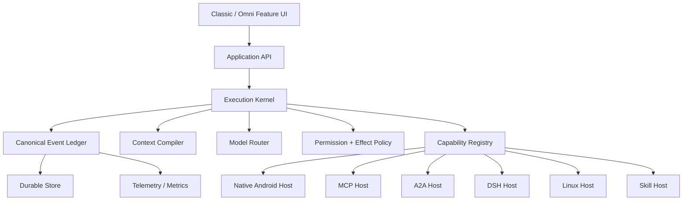

# Nexus 完整架构大改计划与可移交开发指南

> 更新日期：2026-11-10  
> 当前产品：**Nexus**  
> 新仓库：https://github.com/147258369zhh-lgtm/NEW-NEXUS.git  
> 历史基线：Eta 4.11.8，旧基线提交 8f005e3  
> 当前实施阶段：阶段 0 完成；阶段 1 影子账本、retention 与 Timeline Reader 已接入；阶段 2/3 已进入源码；阶段 4 的模式持久化、Goal/Plan 卡和记事本抽屉已接入；阶段 5 的 Host/MCP/Connector/A2A 主干已完成；阶段 6 的统一 ContentPart adapter 已完成；阶段 7/8 已接线 canonical VoiceStateMachine，DSH Host 与真机验收仍受外部条件约束  
> 本文是从任意电脑继续开发的单文件入口；仓库内副本为 docs/NEXUS_PORTABLE_MASTER_PLAN.md。

## 0. 任意电脑恢复开发

1. 克隆新仓库：git clone https://github.com/147258369zhh-lgtm/NEW-NEXUS.git
2. 先读根目录 AGENTS.md 和本文件，再读 docs/nexus/ 下的详细附件。
3. 配置本机 Android SDK 的 local.properties；该文件不得提交。
4. 运行：cmd.exe /c gradlew.bat checkNexusArchitecture :kernel-api:testDebugUnitTest :app:compileDebugKotlin
5. 如果当前仓库还没有首个提交，先检查远程默认分支与本地状态；不要在未获用户授权时自行 init、commit 或 push。
6. 阶段 1 影子账本已接入但不驱动恢复；阶段 2/3 已有 Application API、反向依赖门禁、按需工具目录、ToolGrant 和 Settings 控制面。后续重点是恢复主事实源切换、DSH Host 与真机链路。

Git 硬约束：除只读检查外，任何 init、remote、fetch、pull、branch、merge、rebase、cherry-pick、commit、push、tag、reset、stash 和 history rewrite 都需要用户当次明确授权。

## 1. 当前实际状态

### 已完成到源码层

- 新建独立工程目录，没有修改旧 Eta；原有 D:\AI\Nexus 也未复用。
- 新 applicationId：io.github.zhh_lgtm.nexus，与旧 Eta 并存安装。
- Gradle 根项目、版本、应用标签与 APK 文件名切换为 Nexus。
- 独立自定义权限、无障碍健康 Provider authority、OAuth scheme。
- 新增无 Android、Compose、Room、Miuix 和旧 App 依赖的 kernel-api。
- 固化 Session、Run、Turn、Item、Task、Goal、Plan、Capability、Settings、Migration 契约。
- 完成入口映射、数据库所有权、进程边界和迁移 schema。
- 生成 3315 条逐文件 import 审计：1462 same-layer、945 cross-layer-review、840 UI 直连基线债务、68 forbidden reverse dependencies；data/fork/runtime 对 UI 的禁入门禁已通过，data -> agent 已从 53 降至 37。
- 身份验证、架构检查、Kernel 契约单测、App Kotlin 编译和 Release 构建已通过。
- Nexus Migration v1 JSON Schema 已落盘。
- Release 元数据已确认 applicationId 为 io.github.zhh_lgtm.nexus，输出名为 Nexus-v0.1.0.apk；该包未签名，只用于构建验证，尚未真机验收。
- 新增无 Android、Compose、Room、Miuix 依赖的 application-api 模块。
- data 与 fork 对 ui 的反向 import 已降为 0；agent/runtime 对 ui 已降为 0，并加入 Gradle 门禁。
- Runtime、通知、A2A、Skill 和任务入口使用 NexusUiContract，不再直接引用 MainActivity。
- 附件草稿文件引用模型移入 kernel-api，同时保留旧包名 typealias 兼容调用面。
- 自动归档改为直接查询 pinned 状态和 Runtime active-run 快照；状态不可用时失败关闭。
- 新增能力目录、ToolGrant、CapabilityPolicyEngine、NexusCapabilityDirectory 和默认高风险 effect 分类；主 Agent Loop 已切换为本轮按需加载本地与附加工具 Schema。
- 新增 Settings Control Plane 合同与适配器；Remote Agent 只能提交请求，Secret 不返回明文，审计返回 auditId。
- Goal、Plan、会话记事本已进入持久状态机、revision 和按需工具。
- 工作流模式按会话持久化，Goal/Plan 折叠卡已进入输入框上方，记事本支持顶部下拉、半屏/全屏、自动 revision 保存与 Agent 操作。
- 迁移与备份页已接入旧 Eta 安全迁移向导，复用加密导出、SAF 校验、staging 恢复和重启。
- A2A Transport 已实现统一 HostTransport；Artifact Store 已从 UI 迁入 Data 并增加 Application Ledger。
- MCP Server 已投影到统一 HostAdapterRegistry 和 ToolDescriptor。
- 主会话已加入会话/计划/目标模式切换和模块化记事本 Revision 编辑器。
- 可逆设置审计保存 before/after，并支持当前模型、备用模型和记忆开关真实回滚。
- Release R8 构建已在单次 3 GB Gradle / 2 GB Kotlin daemon 下通过。
- Classic/Omni 已通过 PresentationProfileResolver 和 CompositionLocal 提供正式 Profile。
- 统一 ContentPart renderer 已覆盖文本、Markdown、公式、代码、图片、异步音频、文件、轨迹、计划、用户输入和审批。
- AgentMessageUi 已可携带结构化 ContentPart，普通会话与会议室共享同一渲染路径。
- 外观页增加系统、无衬线、衬线、等宽和 JetBrains Mono 字体选择。
- 统一 AgentRuntimeSession 已接入非阻塞影子 JSONL 账本；不记录正文和敏感参数。
- 影子账本已增加 30 天/200 Run retention 与安全的调试 Timeline Reader。
- 新增 VoiceStateMachine、AudioOwner、WorkloadType 和资源抢占策略。
- LocalVoiceSessionCoordinator 已接入 canonical VoiceStateMachine，Overlay 暴露 canonical snapshot。
- 软件管家新增 `settings.appearance`，并为外观、MCP、Skill 和自学习设置补齐真实回滚快照。
- 新增 DSH Go plugin-kit protocol v1 清单校验器，完成 Host 之前的槽位、ID、capability 与路径预检。
- 新增 Nexus Migration Validator，凭据迁移必须加密，并拒绝重复、过大和错误 schema 的包。

### 尚未完成，不能宣称完成

- 旧 Eta 到 Nexus 的专用迁移向导 UI；现有加密备份、staging 恢复和回滚后端仍可过渡使用。
- 影子 Event Ledger 尚未切换为恢复和 UI 的唯一主事实源，20 Run 对照观察未完成。
- Classic/Omni 的逐页面视觉一致性仍需真机走查；UI 迁移与专用字体分区仍非全部完成。
- 夜间记忆整理、低风险提醒和项目级 Goal 提升。
- DSH Host 本体、全部 DSH UI 插槽、Linux Host 和双向 A2A 真实对端联调。
- 语音和 overlay presentation 从 agent 包迁往 UI 层。
- 更多 Settings 项回滚声明和 DSH Host 本体；MCP Host 注册已实现。
- 真实设备端到端和长时间后台验证。
- 新仓库的提交与推送；当前必须服从“不得随意 Git”。

## 2. 需求追踪矩阵

| 需求域 | 已冻结的产品行为 | 目标阶段 | 当前状态 |
|---|---|---:|---|
| Nexus 产品身份 | 新名称、新 applicationId、与 Eta 并存、独立权限和迁移包 | 0 | 源码基线完成 |
| 上游策略 | 停止常规同步；只人工评估安全或严重兼容修复 | 0/持续 | 已冻结 |
| 数据迁移 | 旧 Eta 加密导出，SAF 导入，staging 校验后原子切换 | 0/8 | 安全迁移向导已接现有加密备份、SAF、staging 与回滚；跨设备换机仍需设备验收 |
| 备份 | 分类备份；凭据加密；模型、Linux、DSH 独立可选包 | 8 | 现有分层备份/恢复后端完成；迁移 UI 与正式发布待验收 |
| 执行内核 | Session、Run、Turn、Item 分离；不可变事件账本；安全恢复 | 0/1/2 | 影子账本已接入，恢复未切换 |
| 工具加载 | 默认只加载能力目录，按需搜索、描述和激活 | 3 | 主 Agent Loop 与 Subagent Loop 已接入 lazy catalogue |
| 工具权限 | 暴露与执行共用白名单；读写查、终端、GUI、Root 分层 | 3 | 策略、分类与单测完成，执行接线未接 |
| 软件管家 | 独立入口和 Agent 可调用技能；统一 Settings Control Plane；全审计 | 3/4 | 控制面、before/after 审计和可逆项回滚已实现 |
| 角色与提示词注入 | 合并模块，Capability Center 风格，强过滤与作用域 | 4 | 设计完成 |
| 记忆与自学习 | 候选、垃圾过滤、管家审核、用户批准、试用、版本化 | 4 | 基线审计完成 |
| 普通会话 | 保持现有体验；修重影、点击、历史栏和运行统计 | 2/6 | 待实施 |
| 会议室 | 主持人监督器加 Agent 工具拓扑；单 @ 直接、多 @ 并行、无 @ 分派 | 4 | 已冻结 |
| 子 Agent | 独立模型、独立上下文、权限交集、状态和轨迹可见 | 3/4 | 已冻结 |
| Goal/Plan | 输入框上方模式切换；计划卡片；预算与用户确认完成 | 4 | 状态机、持久化、模式恢复和折叠卡已完成 |
| 会话记事本 | 会话附件、顶部下拉、半屏或全屏、Revision、Agent 可整理 | 4 | 抽屉、自动 revision 保存和 Agent 操作已完成 |
| 渲染 | 文本、Markdown、公式、代码、图片、音频、文件、轨迹统一 ContentPart | 6 | 统一 adapter 与 AgentMessageUi 接线完成；外部 Host Item 真机验收待做 |
| 上下文压缩 | 可追踪压缩 Item、失败降级、保留原始历史、环状态展示 | 1/6 | 设计完成 |
| UI | Classic/Omni 功能一致；精致材质；精确手势；字体可分设 | 6 | Presentation Profile 已接入，页面迁移待做 |
| 文件管理 | 项目固定输入、输出、Artifact 目录；导入、导出、分享和统计 | 3/5/6 | Artifact Ledger 完成；固定目录 UI 待接 |
| A2A | 双向、动态 Agent Card URL、标准与 PascalCase 别名、前台服务 | 5 | 标准/别名、动态 URL、独立前台服务与出站客户端已落源码；真实对端与锁屏验收待做 |
| A2A 安全 | Tailnet、Card、Token；24 小时会话；高危本机确认；工具高权限仍设限 | 5 | 已冻结 |
| MCP | stdio 与 HTTP 生命周期、诊断、重连、统一 Connector 分类 | 3/5 | stdio/HTTP、诊断、进程生命周期和 HostAdapter 已实现；跨进程真机验收待做 |
| Connector | WebSocket、OpenAPI、Unix Socket、SSE、GraphQL 等统一 SDK | 3/5 | SDK 与主要传输已实现；逐协议真实端点验收待做 |
| DSH 插件 | 远端与本机 Host；全部 UI 插槽验收后才宣称兼容 | 5 | Slot 合同与 plugin-kit v1 清单预检完成；Host 与执行桥待实施 |
| Linux | 独立 Host，多发行版，按需下载，固定项目挂载默认只读 | 5 | 待实施 |
| 语音 | 全双工状态机、音频仲裁、VAD、流式 ASR/TTS、打断 | 7 | canonical 状态已接现有协调器；真机全双工仍待验收 |
| 本地模型 | 分模态、资源预算、按需加载；新下载需确认 | 7 | 后端已有，资源优先级完成 |
| Android 生命周期 | A2A、Goal、定时任务后台持续，进程死亡安全恢复 | 2/5 | 设计完成 |
| 诊断统计 | 本地优先、匿名需授权、运行记录、图表和会话简版统计 | 1/6 | 本地指标与页面已落源码；长时真机数据验收待做 |
| 发布质量 | 每阶段独立验收；稳定版不以代码代替真机证据 | 全部 | 门禁已冻结 |

## 3. 需求来源与参考项目

| 来源 | 采纳内容 | 明确边界 |
|---|---|---|
| Eta 4.11.8 | Runtime、会话、会议室、工具、A2A/MCP、语音、Linux、备份资产 | 只作历史基线和迁移来源，不是常规上游 |
| Eta-por | 数据备份、上下文压缩、Linux 工具、记忆自学习、灵屏、子 Agent、提示词与工具边界、流体云、统计、分支图、顶部切换、文件管理 | 按 Nexus 契约重做，不直接堆叠代码 |
| OmniBot | 第二套 UI Profile、轨迹、外观设置、终端环境、MCP/Skills | Classic 与 Omni 共享业务，功能完整度一致 |
| Operit / Operit2 | 曾用于插件与沙盒包参考 | 用户已决定停止插件沙盒包模块，该方向不进入当前路线 |
| dsh-Go | Host 化、插件系统、按需能力、模块契约 | DSH 必须经 Nexus Extension 与 UI 插槽契约，不穿透内核 |
| Hermes | 记忆、自学习、归档与可审查沉淀 | 垃圾内容不得直接沉淀，必须管家审核后用户批准 |
| Codex / Pi / 主流 Agent | Goal、Plan、事件时间线、执行恢复、能力目录 | 只吸收可验证模式 |
| EdgeGallery | 本地语音与设备侧模型参考 | 统一进 VoiceSession 和模型资源管理 |
| Agent Skills / MCP / A2A | 生态协议 | 全部作为 Host Adapter，不污染 Kernel API |

## 4. 严格阶段顺序

1. 阶段 0：身份、基线、契约、数据所有权、依赖门禁、迁移 schema。
2. 阶段 1：统一影子事件账本、Item 投影、Checkpoint 与 Metrics 对照。
3. 阶段 2：Runtime、UI、Data 解耦，Application API，Store facade。
4. 阶段 3：工具权限、Settings Control Plane、MCP、Skills、插件 Host。
5. 阶段 4：Goal/Plan、会议、记事本、角色提示词、记忆学习。
6. 阶段 5：A2A、DSH、Linux、Connector、项目 Host Mount。
7. 阶段 6：统一渲染、文件管理、统计、Classic/Omni、手势和字体。
8. 阶段 7：语音、本地模型和资源调度。
9. 阶段 8：迁移、分层备份、恢复演练、真机与稳定发布。

禁止提前同时更换执行状态源、数据库主键和 UI 数据路径。每个阶段先建立迁移与回滚，再接 UI。

## 5. 阶段 0 完成定义

已完成身份与并存安装规则、纯 Kotlin 核心契约、禁止依赖检查、入口、数据库、进程边界文档、迁移 v1 schema、逐文件 import 基线，以及架构检查、契约测试和 Kotlin 编译。

全局 package 与类名改名被刻意留到后续，因为旧 Kotlin namespace 与 Eta 前缀类名属于兼容实现细节；新 applicationId、label、权限、authority、scheme、输出文件名和用户可见文案已经隔离。数据迁移与 UI/Runtime 重构也没有伪造完成。

## 6. 阶段 1 的唯一推荐起点

1. 在现有 AgentEvent 消费点增加独立有界队列和单写线程。
2. 建立 execution_runs 与 execution_events 影子存储。
3. 映射 RunStarted、模型请求、Assistant Item、Tool Item、ContextCompaction、RunFinished 和 RunFailed。
4. 普通聊天、会议、Subagent、A2A、定时任务各选真实用例做对照。
5. 写账本失败只记诊断，绝不阻塞 Agent。
6. 关闭开关时必须零新增写入，旧 UI 与 Metrics 行为不变。
7. 观察期通过后才接 Item、Checkpoint 投影，最后才考虑切换恢复依据。

## 7. 架构总纲全文

---


# Nexus 执行内核与产品架构大改总纲（Eta → Nexus）

> 日期：2026-11-10  
> 当前代码基线：`8f005e3`，版本 4.11.8  
> 新产品名：**Nexus**  
> 安装身份：与旧 Eta 完全独立，允许并存安装  
> 状态：需求决策版，可直接作为后续拆解、开发和验收的上位文档  
> Git 约束：本文件不代表已经提交；未经用户再次明确授权，不执行 Git 操作。

## 1. 文档目的

这份文档把此前所有沟通中的产品需求、已验证结论、安全边界和大改方向整理成一套可执行架构。后续开发必须以本文件为总纲；若实现与文档冲突，应先更新决策记录，不能由单个模块自行改变全局语义。

本轮的原则是：

1. 不推倒现有 Runtime 重写。
2. 不让 UI、数据库和第三方插件直接依赖 Runtime 内部实现。
3. 不把所有任务强制变成图。
4. 不为了插件数量牺牲权限、审计和稳定性。
5. 每个大阶段都能独立验收、回滚和停止。
6. 完成标准必须包含自动测试、Release 构建和真机证据，不能以“有代码”代替完成。

## 2. 当前基线

当前项目的主要事实：

- Kotlin、Jetpack Compose、Miuix/Mica 的 Android 应用。
- 单一 Gradle 模块 `:app`。
- 约 926 个 Kotlin 文件、18.5 万行 Kotlin。
- 包括普通会话、会议室、Subagent、定时任务、A2A、MCP、Skills、本地模型、语音、Linux/PRoot、文件与备份。
- `AgentEvent`、运行遥测、Checkpoint 和多个数据存储已经存在，但执行身份和持久状态没有完全统一。
- Runtime 代码存在对 UI/Activity 的直接依赖；部分数据层还依赖 UI model，无法用模块边界阻止反向依赖。
- 当前代码已经能构建和发布，但大改必须以渐进迁移为前提。

## 3. 产品目标

### 3.1 最终产品目标

Nexus 同时面向三个层次：

- 稳定、长期可用的个人 Android Agent。
- 可公开分发、具有完整权限和安全治理的 Agent 平台。
- 可供多人协作开发的开源项目。

三者不是三个不同版本，而是同一架构的三层质量要求：个人版先稳定，公开发布要求更高安全门槛，开源要求模块边界、文档和扩展接口足够清晰。

### 3.2 核心竞争力

- 移动端本地优先：设备、文件、终端、通话、无障碍、Linux 与本地模型。
- 持久执行：跨页面、后台、息屏、进程死亡和设备重启恢复。
- 多宿主：本地 Nexus、远端 DSH、SSH、Linux、MCP、A2A。
- 多模型：用户定义路由顺序，按任务、成本、隐私和能力自动选择。
- 可扩展：MCP、Agent Skills、DSH/Cordis 插件、Connector、平台 Hook。
- 可治理：全局审计、权限白名单、插件隔离、记忆审核和可回滚学习。

### 3.3 明确不做

- 不把第三方插件代码直接运行在 Compose/UI 主进程。
- 不承诺 Android 进程永不终止。
- 不允许模型自行批准 Root、终端、Subagent、自动化或删除等高危操作。
- 不把完整 DSH、Linux 和模型文件默认塞入每一次完整备份。
- 不因多 Agent 增加而无上限并发调用模型。
- 不长期同步上游代码；只允许人工评估后移植关键安全或兼容修复。

## 4. 核心对象模型

### 4.1 Session

用户可见的一段长期会话或会议室。Session 只保存身份、作用域、用户可见标题和元数据，不作为执行过程的唯一事实源。

### 4.2 Run

一次完整提交及执行生命周期。Run 拥有不可变的 `runId`，记录来源、Host、会话、目标、模型策略、预算和终止状态。

Run 来源至少包括：

```text
chat
meeting_host
meeting_participant
subagent
goal
a2a_inbound
a2a_outbound
automation
note_consolidation
plugin
```

### 4.3 Turn

一次模型请求及其产生的工具批次。一个 Run 可以有多个 Turn。

### 4.4 Item

不可变、可持久化的执行记录，包括：

- 用户消息。
- Agent 消息。
- Reasoning summary。
- 工具调用。
- 工具结果。
- 文件或图片产物。
- 上下文压缩记录。
- 子 Agent 事件。
- 用户输入请求。
- 审批请求。
- 计划修订。
- 验证结果。

实时事件与历史读取必须使用同一套 Item 语义，避免 UI 显示和恢复状态不一致。

### 4.5 Task 与 Goal

Task 表示需要跨回合、后台、等待、恢复或调度的工作。普通闲聊不强制生成节点图。

Goal 是目标模式的持久目标，至少包含：

- 目标描述。
- 约束。
- 完成条件。
- 当前计划。
- 预算与硬上限。
- 用户批准状态。
- 验证证据。
- 作用域：会话或项目。

### 4.6 Plan

计划模式生成版本化 Plan 文档。计划中的步骤需要声明：

- 目的。
- 依赖。
- 工具与权限。
- 效果类型。
- 预估成本。
- 验证方式。
- 可逆性。

### 4.7 Artifact

文件、图片、音频、网页、长文本和大型工具输出统一作为 Artifact 保存，记录生成 Run、节点、哈希、大小和来源。

### 4.8 Extension

第三方能力统一表示为 Extension。Extension 可以来自 MCP、Skills、DSH/Cordis、Connector、Android Hook 或本地插件，但必须先转换为 Nexus 的公共 Tool/Presentation 契约。

## 5. 目标分层



### 5.1 UI 层

负责展示和输入，不直接写 Runtime 数据库，不直接执行工具和插件。

### 5.2 Application API

Feature 与执行内核之间的稳定门面，提供提交、取消、steer、审批、读取时间线等能力。

### 5.3 Execution Kernel

负责 Agent Loop、Turn、上下文、模型路由、工具调用、验证、取消、预算、暂停和恢复。

### 5.4 Canonical Event Ledger

唯一持久执行事实源，所有 UI、指标、诊断和恢复都从它投影。

### 5.5 Host

负责与执行内核外的环境交互：Android、Linux、远端 DSH、MCP、A2A、SSH、Hook。

## 6. 模块化目标

### 6.1 建议 Gradle 模块

```text
:kernel-api
:kernel-engine
:kernel-store
:capability-api
:provider-api
:platform-android
:host-mcp
:host-a2a
:host-dsh
:host-linux
:host-skills
:presentation-api
:ui-foundation
:feature-chat
:feature-meeting
:feature-tasks
:feature-settings
:app
```

初始实施可以合并部分 Host 模块，但依赖方向必须从第一天确定。

### 6.2 依赖规则

```text
kernel-api
  ↑
kernel-engine / store interfaces
  ↑
platform / host adapters
  ↑
features
  ↑
app
```

硬性规则：

- `kernel-api` 不依赖 Android、Compose、Room、MCP、DSH。
- `kernel-engine` 不依赖 Feature UI 和具体 Host。
- Host 不依赖 Feature UI。
- Feature 之间不能相互导入。
- UI 不能直接访问 DAO、SharedPreferences 或 Runtime 内部单例。
- 第三方插件不得依赖 Nexus Runtime 的内部类。
- 接口只放在稳定模块边界；模块内部不为每个类制造接口。

### 6.3 会话与会议室

业务域保持独立：

- `ChatController`
- `MeetingRoomController`
- `GoalController`

共享基础设施：

- ConversationSurface。
- Composer。
- MessageRenderer。
- ToolTrace。
- AttachmentPanel。
- FilePanel。
- Permission UI。
- Runtime API。

不共享巨大的业务 ViewModel。

## 7. 执行内核

### 7.1 Run 状态机

```text
CREATED
  → ADMITTED
  → RUNNING
  → WAITING_USER
  → WAITING_AUTH
  → PAUSED
  → VERIFYING
  → SUCCEEDED / FAILED / CANCELLED / INTERRUPTED
```

计划模式与目标模式：

```text
DRAFT
  → WAITING_PLAN_APPROVAL
  → RUNNING
  → VERIFYING
  → WAITING_USER
  → COMPLETED / FAILED / CANCELLED / BUDGET_PAUSED
```

审批和用户输入必须是暂停状态，不是新用户 Turn。

### 7.2 事件账本

事件必须包含：

- runId。
- 单调递增 sequence。
- session/turn/item 关联。
- source。
- hostId。
- 事件种类。
- 状态。
- 时间与耗时。
- 预算用量。
- 错误类别。
- 持久 payload 或 Artifact 引用。

不得以数据库自增 ID 作为执行顺序。

### 7.3 观察与回放

- 实时 UI 消费 Event。
- 历史 UI 消费投影后的 Item。
- 指标消费遥测投影。
- 恢复消费 checkpoint 与最后一个已验证 Item。

### 7.4 恢复规则

- PURE/READ：可以自动重试。
- 幂等写入：要求稳定 idempotency key，成功后可重放。
- 可验证副作用：恢复前先查询真实状态。
- 不可逆写入、外部提交、GUI：默认等待用户。
- 连续崩溃达到上限后停止恢复并报告，不允许无限 crash loop。

### 7.5 并发

同一普通会话：

- 一个主 Run。
- 最多一个受预算约束的后台 Goal Run。
- 其他输入排队或 steer。

会议室：

- 默认最多 4 个参与者并行。
- 根据预算和资源自动降低。
- 同一文件写入通过 Effect Lease 串行化。

## 8. 上下文与工具加载

### 8.1 默认策略

模型默认只接收能力目录，按需检索和读取工具、Skill、记忆和附件。

上下文层：

- Stable：身份、核心规则、简短工具目录。
- Project：AGENTS.md、项目范围、工作区文件索引。
- Volatile：当前回合、相关记忆、附件和审批。
- Step：当前节点所需的工具 Schema、Artifact 和证据。

### 8.2 工具加载级别

```text
L0 常驻：tool_search、tool_describe、tool_activate、capabilities_status
L1 目录：名称、短描述、权限、效果、可用性
L2 激活：完整参数 Schema
L3 详情：示例、长说明、资源和插件文档
```

### 8.3 热门工具

根据最近调用、成功率、任务类型和切换成本动态预加载。

- 默认热门工具数量：6～12。
- 动态上限：16。
- 任务明确时允许本地路由临时覆盖。
- 工具发现按 Run/会话缓存。
- 不把热门工具状态写入 System Prompt 或长期记忆。

### 8.4 防止上下文坍塌

- 原始历史不删除。
- 压缩生成新的 Item。
- 保存上下文选择依据和保留依赖。
- 记录压缩前后 token 与原因。
- 工具结果按需截断，完整内容进入 Artifact。

## 9. 模型路由

### 9.1 路由顺序

用户维护模型与 Provider 的优先级，而不是系统固定本地优先或费用优先。

每个路由目标声明：

- Provider/模型。
- 本地或云端。
- 能力与模态。
- 上下文和工具支持。
- 数据许可范围。
- 成本与速率限制。
- 是否允许自动回退。

### 9.2 默认数据政策

- 当前对话和明确引用的任务内容可进入当前 Run。
- 长期记忆、记事本、附件、截图、语音和项目文件需按范围授权。
- 默认仅当前 Run。
- 可保存为会话或全局规则。

### 9.3 回退

- 允许跨供应商自动降级。
- Provider 必须满足当前数据范围。
- 不满足时跳过。
- 所有 Provider 都不满足时停止并说明。
- 不通过删除敏感上下文绕过政策。

### 9.4 本地模型

- 已安装模型可自动加载。
- 新模型下载必须确认。
- 区分 LLM、Vision、ASR、TTS、VAD、Embedding、Image Generation。
- 声明 CPU/GPU/NPU 和内存预算。
- 按资源压力卸载空闲模型。

## 10. 工具与权限系统

### 10.1 ToolDescriptor

```text
ToolDescriptor
- id / namespace
- modelDescription
- inputSchema / outputSchema
- requiredCapabilities
- effectClass
- idempotency
- timeout
- verifier
- concurrencyKey
- replayPolicy
- presentationSchema
- hostKind
```

### 10.2 执行后端

优先级：

1. 公开 Android API/SAF/Intent。
2. 用户授权的无障碍或通知能力。
3. 用户主动选择的 Shizuku/无线 ADB。
4. 用户安装的 PRoot/Linux Host。
5. Root 仅在显式启用后使用。
6. 远端 Host 独立选择。

缺少权限时停止并请求，不自动跨级升级。

### 10.3 权限维度

- 执行后端是否可用。
- 用户是否授权。
- 当前任务是否允许。
- 工具是否在 Peer/Plugin 白名单中。
- 作用域是否匹配。
- 当前 Host 是否支持。

### 10.4 效果类型

```text
READ
REVERSIBLE_WRITE
IDEMPOTENT_WRITE
NON_IDEMPOTENT_WRITE
DESTRUCTIVE
EXTERNAL_SIDE_EFFECT
GUI_ACTION
HIGH_RISK
```

## 11. 扩展与插件系统

### 11.1 ExtensionHost 接口

```text
inventory()
connect()
listCapabilities()
describeTools()
invoke()
cancel()
subscribeEvents()
disconnect()
```

### 11.2 Host 类型

- Native Android Host。
- MCP Host。
- Agent Skills Host。
- DSH/Cordis Host。
- Linux Host。
- A2A Host。
- Optional Hook/LSPosed Host。

### 11.3 隔离

- 内置可信工具可以在 Nexus 主 Runtime 进程。
- 第三方插件运行在共享但独立的 Sandbox Host。
- 每个插件有独立权限和资源配额。
- 最近使用的插件可保持热态。
- 闲置 30 分钟后按内存压力回收。
- 插件崩溃只影响自身，宿主撤销其资源和任务。

### 11.4 插件安装与审计

来源支持：

- 官方索引。
- 签名第三方源。
- Git 仓库。
- 本地包。

首次安装、版本变化、来源变化、权限变化或哈希变化时必须重新审计：

- 包哈希与签名。
- 权限清单。
- 安装脚本。
- 动态代码。
- 依赖扫描。
- 危险 API。
- 隔离试运行。
- Agent 风险解释。

Agent 审计只能降低风险，Root 能力必须由用户最终确认。

### 11.5 声明式 UI

插件 UI 使用受控 JSON/组件树和 Effect 白名单，不直接在 Compose 主进程执行插件代码。

DSH 插件兼容要求：

- 同时覆盖远端 DSH Host 和本机 DSH Host。
- 固定 DSH 版本并维护完整插槽目录。
- 首批实现必须达到全部插槽验收，才可发布“支持 DSH”的稳定版。
- 不支持原生渲染的页面可使用隔离 WebView。
- WebView 只访问已配对 DSH Host，隔离 Cookie、存储、导航和桥接。
- 无法显示时必须说明原因。

### 11.6 本机 DSH 与本机 Linux

- 本机 DSH 是按需下载的独立运行包。
- 与普通 Linux Host 隔离。
- 通过显式项目挂载共享文件，默认只读。
- 应用升级默认复用已有 Host。
- Host 更新失败保留旧版本并回退。

## 12. A2A

### 12.1 网络与身份

- 同一 Tailnet 节点可以自动发现并加入可信列表。
- 入信必须同时满足 Tailnet 地址、Agent Card 和 Bearer Token 匹配。
- 首次通过认证的请求启动 24 小时安全会话。
- 节点退出 Tailnet、地址/身份变化、Token 撤销或设备丢失时立即终止会话。
- Agent Card URL 使用请求 Host 或显式地址动态生成，不硬编码。

### 12.2 工具权限

- 文件访问范围是用户授予 Nexus 的内容目录。
- 不包括 App 数据库、Keystore、凭据、Token 和系统密钥。
- 读取、写入、删除、终端、Root、自动化、Subagent 分别授权。
- 高危工具可申请，但每次都必须由本机用户确认。
- 远端 Agent 不能自行批准。

### 12.3 高危审批

- 本地通知只显示任务名和等待类型。
- 进入 Nexus 后显示原始命令/目标路径、影响对象、副作用和预算。
- 可以展开完整详情。
- 超时后拒绝当前工具，不取消整个任务。
- 结果返回远端时明确标记为用户未批准。

### 12.4 文件与项目

- 可以访问用户授予 Nexus 的所有内容文件。
- 越权访问 App 私有数据、凭据和系统密钥必须拒绝。
- 写入和删除需要对应工具权限与审批。

## 13. 会议室与子 Agent

### 13.1 拓扑

主持人监督器 + Agent 作为工具：

- 用户明确 @ 单个 Agent：直接执行。
- 用户明确 @ 多个 Agent：并行执行独立任务。
- 未 @：主持人分析和分派。
- 主持人汇总或等待用户下一轮。

### 13.2 上下文

- 主持人获取完整用户任务。
- 参与者只取得自己的任务、必要文件和有界上下文。
- 成员间禁止自由广播和无限互聊。
- 子 Agent 权限是父 Agent、Profile、当前任务和 Peer 策略的交集。

### 13.3 生命周期

- 常规参与者是用户配置的长期 Agent。
- 主持人可创建临时专家，受模型白名单、工具、并发和预算限制。
- 临时 Agent 默认会议结束后销毁。
- 父子 Run 拥有独立预算、取消和验证。
- 默认最多 4 个并行参与者，按资源自动降低。

## 14. 目标模式与计划模式

### 14.1 入口

- 输入框上方提供普通、计划、目标模式切换。
- 复杂任务可由 Agent 建议进入计划模式，但不自动进入。
- 运行时计划以可折叠卡片展示。

### 14.2 计划模式权限

允许：

- 修改 Plan。
- 修改会话记事本 revision。
- 创建提醒草稿。
- 读取会话和项目。

禁止：

- 修改项目文件。
- 修改设置。
- 执行终端、Root、GUI、外部消息。
- 安装插件。
- 提交 A2A 任务。

### 14.3 目标模式

- Goal 属于会话。
- 可显式提升到项目，在项目内多个会话继续。
- 全局默认预算 + 单次覆盖 + 系统硬上限。
- 默认软预算示例：10 轮、15 分钟、100 次工具。
- 达到软预算暂停并请求增加、延长或结束。
- 验证器提供证据，用户最终确认完成。

## 15. 会话记事本

### 15.1 定位

会话记事本是一个会话附件，不是全局记事本，也不自动晋升为长期记忆。

### 15.2 UI

- 仅在会话时间线位于顶部时，向下拉出抽屉。
- 先显示半屏预览。
- 可上拉全屏编辑。
- 流式自动保存 Revision。
- 抽屉内提供整理、总结、生成计划和执行按钮。

### 15.3 Agent 访问

- 默认不进入每轮上下文。
- 用户手动触发，或夜间/息屏后的后台任务读取。
- Agent 可以直接整理、改写整个记事本。
- 每次修改生成 revision，不允许静默丢失历史。
- 用户编辑与 Agent 编辑冲突时先预览合并。
- 需要长期保存时由用户显式导出或提升为记忆。

## 16. 夜间整理、记忆与自学习

### 16.1 作用域

```text
会话记忆 → 项目记忆 → 全局记忆
```

升级作用域需要确认。

### 16.2 夜间任务

触发条件可配置：时间段、充电、设备空闲和网络。

输出：

- 记事本 revision。
- 提醒候选。
- 计划候选。
- 低置信度候选。

低风险本地提醒可以自动创建；计划和重要操作需要确认。外部消息、项目文件、Root、插件安装和 A2A 任务禁止自动执行。

### 16.3 学习流程

```text
运行证据
  → 候选
  → 垃圾与敏感信息过滤
  → 冲突检测
  → 软件管家审核
  → 用户批准
  → 小范围试用
  → 效果评估
  → 正式版本
  → 可回滚
```

软件管家只能提高审计质量，不能绕过用户最终批准。

## 17. 内容渲染

统一 `ContentPart`：

- Text。
- Markdown。
- Math。
- Code。
- Image。
- Audio。
- File。
- ToolTrace。
- Artifact。
- PlanCard。
- UserInputRequest。
- ApprovalRequest。

普通会话、会议室、目标模式和 DSH 插件都通过统一渲染器；会议室只增加主持人、成员任务和并行状态。

语音消息包含音频、时长、波形、转写、流式状态和播放控制。

## 18. UI 与外观

### 18.1 两套 Profile

- Classic：源自现有 Eta、继续沿用 Miuix 视觉语言的 Nexus 风格。
- Omni：OmniBot 启发下的独立布局与完整视觉 Profile。

共享：

- Session、Run、Goal、Meeting。
- Navigation state。
- Runtime 和工具策略。
- 数据与行为。

不同：

- 设计 token。
- 圆角、字体、材质、图标和动效。
- 页面布局 Profile。
- 个别页面组件呈现。

Classic 与 Omni 功能完整度必须一致，所有新功能两套 UI 同步验收。

### 18.2 字体

分别配置：

- 界面字体。
- 正文阅读字体。
- Markdown 字体。
- 代码/终端等宽字体。
- 数字与公式字体。
- 字号、行高和字重。

支持系统、内置和用户导入字体；每类字体必须有 fallback、格式校验、大小限制和许可证信息。

### 18.3 手势

- 会话区域顶部下滑：打开记事本抽屉。
- 输入框上方：普通/计划/目标模式。
- 主页面中间右滑：会话/会议室切换。
- 会话详情左滑：运行统计和项目文件。
- 历史会话右滑：置顶。
- 历史会话左滑：删除。
- 长按：拖动和更多操作。

手势只在明确区域启用，避免与系统返回、滚动和通知栏冲突。

## 19. 项目、文件与统计

### 19.1 目录优先级

```text
Run 临时目录
  > 会话覆盖目录
  > 项目默认目录
  > App 默认工作区
```

### 19.2 项目绑定

项目设置集中配置：

- 默认输入目录。
- 默认输出目录。
- Artifact 目录。
- 挂载到 Linux/DSH 的方式。
- 只读或读写权限。

文件页显示当前绑定、可访问状态、导入/输出数量和错误。

### 19.3 Artifact Ledger

记录：

- Run、工具、会话和项目。
- 输入、输出、临时、分享和备份分类。
- 路径/URI、大小、哈希和时间。
- Host 映射关系。
- 是否已导出、分享或清理。

### 19.4 跨 Host

- 项目是共享身份。
- Host 显式挂载同一文件范围。
- 默认只读。
- 写入由 Host 级配置和工具权限共同控制。
- SAF 授权撤销后需要重新绑定。

## 20. 设置控制面

### 20.1 权限来源

- 普通会话中的本地主 Agent、长期 Agent 和临时 Agent 可以读取并修改设置。
- 软件管家是同一控制面的专用入口，拥有批量检查与审计能力。
- A2A/DSH 远端 Agent 只能提交设置变更申请。
- 会议室、定时任务按来源策略处理。

### 20.2 安全不变量

- 审计和回滚不可关闭。
- API Key、Token、密码不可读取明文。
- 密钥只能设置、替换和清除。
- Agent 的修改不能绕过权限、审计和恢复系统。
- 安全控制面必须独立于 Agent Loop。

### 20.3 SettingDescriptor

```text
id
displayName
type
scope
allowedValues
currentValue
sensitive
riskLevel
requiresApprovalForRemote
undoAvailable
getter
validator
setter
```

每次修改记录 Agent、Run、来源、旧值、新值、时间和撤销状态。

## 21. 语音

### 21.1 首版基础层

- VoiceSession 状态机。
- AudioRecord/AudioTrack。
- Audio Focus。
- VAD。
- 流式 ASR/TTS 接口。
- 用户说话打断 TTS。
- 麦克风与播放仲裁。
- 前台服务与权限状态。

### 21.2 权限

- 默认仅在用户主动语音会话时打开麦克风。
- 唤醒词是独立授权能力。
- 任何 Agent 都不能无提示开启麦克风。
- 可分别选择本地或云端 ASR/TTS。

## 22. 本地模型与资源

### 22.1 模型类型

- LLM。
- Vision。
- ASR。
- TTS。
- VAD。
- Embedding。
- Image Generation。

### 22.2 资源优先级

```text
前台对话
  > 用户主动任务
  > 夜间整理
  > 插件 Host 预热
  > Linux 空闲服务
```

高优先级资源不足时，低优先级任务暂停、卸载或延后。

### 22.3 生命周期

- 语音模型使用时加载。
- 闲置后按内存压力卸载。
- 已安装模型可以自动加载。
- 新模型下载必须确认。
- 空闲插件 30 分钟后按压力回收。

## 23. 备份、恢复与迁移

### 23.1 备份分层

- 设置。
- 会话与消息。
- 会议室。
- 项目与文件。
- 记忆、学习和 Skill。
- MCP、A2A、DSH 与 Connector 配置。
- 定时任务与 Goal。
- 凭据。
- 本地模型。
- Linux/DSH Host。

### 23.2 默认策略

- 普通备份不包含模型、Linux rootfs、DSH Host 和大型插件二进制。
- 包含配置索引和恢复要求。
- 模型/Host/插件可生成独立可选包。
- 大备份支持排除缓存、去重、增量、分卷和流式导出。

### 23.3 凭据

- 用户勾选后才包含。
- 必须使用备份密码加密。
- 导入后由目标设备 Keystore 重新包裹。
- 绝不跨设备复用旧 Keystore 密文作为最终存储。

### 23.4 从旧 Eta 4.11.8 迁移

- Nexus 使用新的应用名、applicationId、安装沙盒和后续独立的签名身份，不能覆盖安装旧 Eta。
- Android 不允许普通应用直接读取另一个 applicationId 的私有数据，因此不能承诺跨包原地自动迁移。
- 旧 Eta 先导出加密迁移包；Nexus 首次启动提供迁移向导，通过 SAF 导入。
- 普通无 Root/Shizuku 环境不得通过私有路径直接读取旧 Eta 数据库。
- 迁移包需要包含清单、版本、哈希、数据库、项目文件引用、记忆、学习、任务、Skill/MCP/A2A 配置及可选加密凭据。
- 导入先进入 staging，校验成功后再原子激活；失败继续保留 Nexus 初始数据。
- 兼容层可以暂时存在，但不能成为永久双写源。

### 23.5 Nexus 产品身份

- 用户可见产品名统一为 Nexus。
- 推荐 applicationId：`io.github.zhh_lgtm.nexus`；正式发布前再确认是否使用最终反向域名。
- 旧 Kotlin namespace 可以暂时保留以减少无业务收益的全局改名，但 Manifest label、Gradle applicationId、应用图标、通知、导出格式和用户可见文案必须使用 Nexus。
- Nexus 使用独立数据目录、独立通知渠道、独立 A2A 服务标识和独立备份格式版本。
- 正式 Nexus 包使用独立签名密钥；不得复用或提交明文签名密码。
- 旧 Eta 与 Nexus 可以并存，数据迁移只通过显式迁移包，不做隐式共享。

## 24. 诊断与遥测

- 默认全部本地。
- 匿名上传必须显式开启。
- 常规遥测只包含 ID、状态、耗时、错误类别和版本。
- 提示词、参数、结果、文件、截图和语音另需授权。
- 诊断包默认不含数据库。
- 附加数据库必须展示大小、敏感类别和用途。
- DSH/MCP/插件 Host 的诊断按各自边界管理。

## 25. Android 生命周期

- 实时长任务使用前台服务。
- 定时和延迟触发使用 WorkManager；精确提醒使用 Alarm 能力并说明系统限制。
- 应用退后台后任务继续。
- 从最近任务划掉不主动取消任务。
- 进程死亡后保留 checkpoint，重启后恢复安全操作。
- 设备重启后恢复 A2A、已启用定时任务和可恢复 Goal。
- 高危操作恢复前重新检查权限。
- 空闲时降低探测、整理和插件预热频率。

## 26. 工程治理

### 26.1 上游策略

- 停止常规上游同步。
- 当前代码作为最后历史基线归档。
- 保留许可证、NOTICE 和作者署名。
- Provider、SDK、依赖和安全更新由 Nexus 团队自行维护。
- 关键安全或严重兼容修复允许人工评估后最小移植。

### 26.2 代码规范

- 公共契约使用不可变数据类。
- 跨模块只暴露最小 API。
- 禁止 Feature 相互依赖。
- 禁止数据库实体直接进入 UI。
- 禁止第三方协议类型进入 Kernel。
- 所有持久状态带 schemaVersion。
- 所有工具声明权限、效果、超时和并发键。
- 新增数据库迁移必须可重复验证并具备失败回滚。
- 新增 Host 必须通过统一 Contract Test。

### 26.3 完成等级

```text
L0 设计
L1 源码
L2 自动测试
L3 Release 构建
L4 真机端到端
L5 长时间/异常恢复
```

高风险能力只有 L4/L5 才能标为完成。

## 27. 实施阶段

### 阶段 0：基线冻结与契约设计

工作：

- 建立模块依赖图和现有调用图。
- 固化 Session/Run/Turn/Item/Task/Goal/Plan/Artifact 契约。
- 固化 ToolDescriptor、CapabilitySnapshot、EffectClass、HostAdapter、SettingsDescriptor。
- 定义数据库迁移和版本策略。
- 建立禁止反向依赖的架构测试。

验收：

- 架构决策记录完成。
- 公共类型不依赖 Android/Compose。
- 所有现有入口能映射到新对象模型。

### 阶段 1：持久执行账本

工作：

- 从 AgentEvent 接入统一 Event Ledger。
- 建立 Item 投影、Checkpoint 和恢复游标。
- 保留现有对话和 Metrics 兼容。
- 引入崩溃上限、幂等键和 effect policy。

验收：

- 普通聊天、会议、A2A、定时任务的 Run 都进入同一账本。
- 进程死亡后可识别最后安全 checkpoint。
- 不可逆操作不自动重放。

### 阶段 2：模块边界与 Runtime 解耦

工作：

- 提取 kernel-api、kernel-store、provider-api、capability-api。
- Runtime 移除对 MainActivity/UI model 的直接依赖。
- UI 改为依赖 Application API。
- 建立 Host Adapter 和 Settings Control Plane。

验收：

- Feature 不相互依赖。
- Kernel 不依赖 Compose/Activity。
- 单模块行为不变。
- Release 构建通过。

### 阶段 3：工具与扩展平台

工作：

- 能力目录与按需加载。
- 动态热门工具。
- 统一权限与效果检查。
- MCP、Skills、A2A、DSH Host 实现统一接口。
- 插件审计、共享 Sandbox Host、热态回收。

验收：

- 不可用工具不进入模型 Schema。
- 同一个白名单同时控制暴露与执行。
- 第三方插件崩溃不影响主 Runtime。
- Root 插件操作逐次确认。

### 阶段 4：目标、计划、会议与记事本

工作：

- Goal/Plan 状态机。
- 内联用户输入卡片和审批。
- 会议室长期 Agent 与临时专家。
- 会话记事本下拉抽屉、Revision 和 Agent 按钮。
- 后台 Goal 与定时任务关联。

验收：

- 计划模式白名单生效。
- 目标预算、完成验证和用户确认正确。
- 记事本修改可撤销。
- 会议室默认 4 并发并可自动降低。

### 阶段 5：A2A、DSH、Linux 与文件 Host

工作：

- Tailnet 自动发现、三重身份校验和 24 小时会话。
- 高危本地审批。
- 本机/远端 DSH Host 和完整插槽目录。
- Linux 多发行版 Host。
- WorkspaceBinding、Host mount、Artifact Ledger。

验收：

- A2A 标准/PascalCase 方法均可用。
- 高危命令展示完整信息和预算。
- DSH 未完成全部插槽时正式版不宣称兼容。
- 文件跨 Host 映射与只读默认正确。

### 阶段 6：统一渲染与双 UI

工作：

- ContentPart 消息模型。
- Markdown、公式、代码、图片、音频、文件、工具轨迹统一渲染。
- Classic/Omni 设计 token 和布局 Profile。
- 字体设置。
- 会话/会议导航和手势修复。

验收：

- 普通会话与会议室所有内容类型一致。
- Classic/Omni 功能一致。
- 字体缺失自动回退。
- 无重影、导航错误和大面积空白。

### 阶段 7：语音与本地模型

工作：

- VoiceSession 状态机。
- 音频仲裁、VAD、流式 ASR/TTS 和打断。
- 本地/云端语音 Provider。
- 本地模型资源管理与卸载。
- 模型下载、校验、回退和指标。

验收：

- 录音、播放和打断不互锁。
- 前台任务优先于模型预热。
- 新模型下载必须确认。
- 语音停止失败可超时回收。

### 阶段 8：迁移、备份和稳定发布

工作：

- 4.11.8 数据迁移。
- 分层备份、凭据加密、独立大包。
- 恢复和回滚演练。
- 长时后台、Doze、重启和 ROM 兼容。

验收：

- 旧数据完整迁移。
- 迁移失败不切换旧数据库。
- 备份可导入、可验证、可回滚。
- A2A、目标、会议和定时任务在真机端到端通过。

## 28. 优先级

### P0

- 数据迁移和回滚。
- 统一执行账本。
- 工具白名单与权限执行一致。
- UI 导航空状态、重影、上下文环和运行统计。
- 普通聊天/会议室执行稳定性。

### P1

- Goal/Plan。
- 会话记事本。
- 项目目录绑定与 Artifact Ledger。
- A2A 安全会话和高危审批。
- MCP、Skills、DSH Host。

### P2

- Classic/Omni 双 UI 完整验收。
- 字体系统。
- 本地模型资源优化。
- 语音基础层。

### P3

- 全双工语音模型适配。
- 更高级的 Linux/插件生态。
- 灵屏、流体云和高级可视化。

## 29. 验收矩阵

### 执行

- 普通聊天 20 轮连续执行。
- 会议室未 @、单 @、多 @。
- Goal 暂停、恢复、预算耗尽。
- A2A SendMessage/GetTask/CancelTask 和标准别名。
- 进程死亡、重启、息屏、划掉任务。

### 数据

- 4.11.8 到新版本迁移。
- 迁移中断恢复。
- 备份分类、加密、导入和回滚。
- 旧凭据重绑定。

### 权限

- 未授权工具不进入 Schema。
- 伪造调用被拒绝。
- Root/terminal/A2A 高危审批。
- 插件撤销资源。
- Secret 不可读。

### UI

- 360/412/600dp。
- 浅色、深色、纯黑。
- 大字体和自定义字体。
- Classic/Omni。
- 手势、滚动、键盘和弹窗层级。
- Markdown、公式、代码、图片、音频和文件。

### 性能

- 前台对话不被后台 Linux/插件阻塞。
- 热门工具不重复搜索。
- 工具 Schema 数量有上限。
- ASR/TTS 可打断并释放资源。

## 30. 开发前固定规则

1. 未经用户明确授权，不执行 Git 操作。
2. 不在一个大提交中同时重写 Runtime、数据库和 UI。
3. 每次只引入一种事实源。
4. 每阶段先写迁移和回滚，再接 UI。
5. 任何安全边界不能只靠 Prompt 实现。
6. 任何插件或 Host 崩溃必须局部隔离。
7. 任何完成声明必须对应证据等级。

## 31. 开发启动条件

正式实施从阶段 0 开始。阶段 0 只允许新增契约、依赖规则、架构文档和只读审计，不直接重构现有执行逻辑。

进入阶段 1 前必须满足：

- 对象模型和事件语义稳定。
- 模块依赖图完成。
- 数据迁移草案完成。
- 所有现有入口映射完成。
- 阶段 0 编译、静态检查和 Release 构建通过。

本文件是后续开发的总上位文档。每次实施必须先引用对应阶段，完成后回填证据、偏差和剩余风险。


---

## 8. 详细附件索引

- docs/nexus/00_PROGRAM_CHARTER.md：产品章程、不可破坏约束、关键决策。
- docs/nexus/01_BASELINE_INVENTORY.md：基线代码、数据库、入口和风险。
- docs/nexus/02_CORE_CONTRACTS.md：对象、工具、权限、Presentation 契约。
- docs/nexus/03_SEQUENCED_ROADMAP.md：完整阶段顺序与门禁。
- docs/nexus/04_PHASE0_WORK_BREAKDOWN.md：第一阶段工作分解。
- docs/nexus/05_BASELINE_DEPENDENCY_MATRIX.md：顶层依赖与循环。
- docs/nexus/06_PHASE1_SHADOW_EVENT_LEDGER.md：影子账本设计。
- docs/nexus/07_BASELINE_IMPORTS.csv：3165 条逐文件 import 审计。
- docs/nexus/07_ENTRYPOINT_AND_RUN_SOURCE_MAP.md：统一 RunSource 映射。
- docs/nexus/08_DATABASE_OWNERSHIP.md：数据库唯一 owner。
- docs/nexus/09_PROCESS_AND_SERVICE_BOUNDARIES.md：Android 进程、服务和后台恢复边界。
- docs/nexus/10_PHASE0_ACCEPTANCE.md：阶段 0 验收证据与遗留项。
- docs/nexus/schemas/nexus-migration-v1.schema.json：迁移清单 JSON Schema。
- scripts/generate_nexus_dependency_audit.py：重新生成 import 审计。
- scripts/verify_nexus_identity.py：安装身份碰撞检查。

## 9. 移交时不得误报的事项

- “代码能编译”只代表 L1/L2 基线，不代表 UI、A2A 或迁移已在真机工作。
- 当前远程仓库即使存在地址，也不代表本地工作已提交或推送。
- DSH 未完成全部插槽时，任何稳定版不得宣称 DSH 插件兼容。
- A2A 入站必须复用同一 Agent Loop 与工具解析器，不能恢复成一次简化模型调用。
- 根权限、删除、外部提交和 GUI 高危动作不能由 Agent 自主批准或自动恢复。
